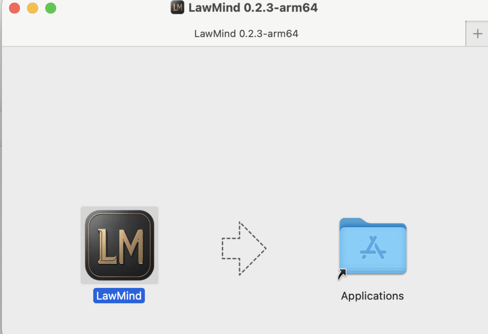
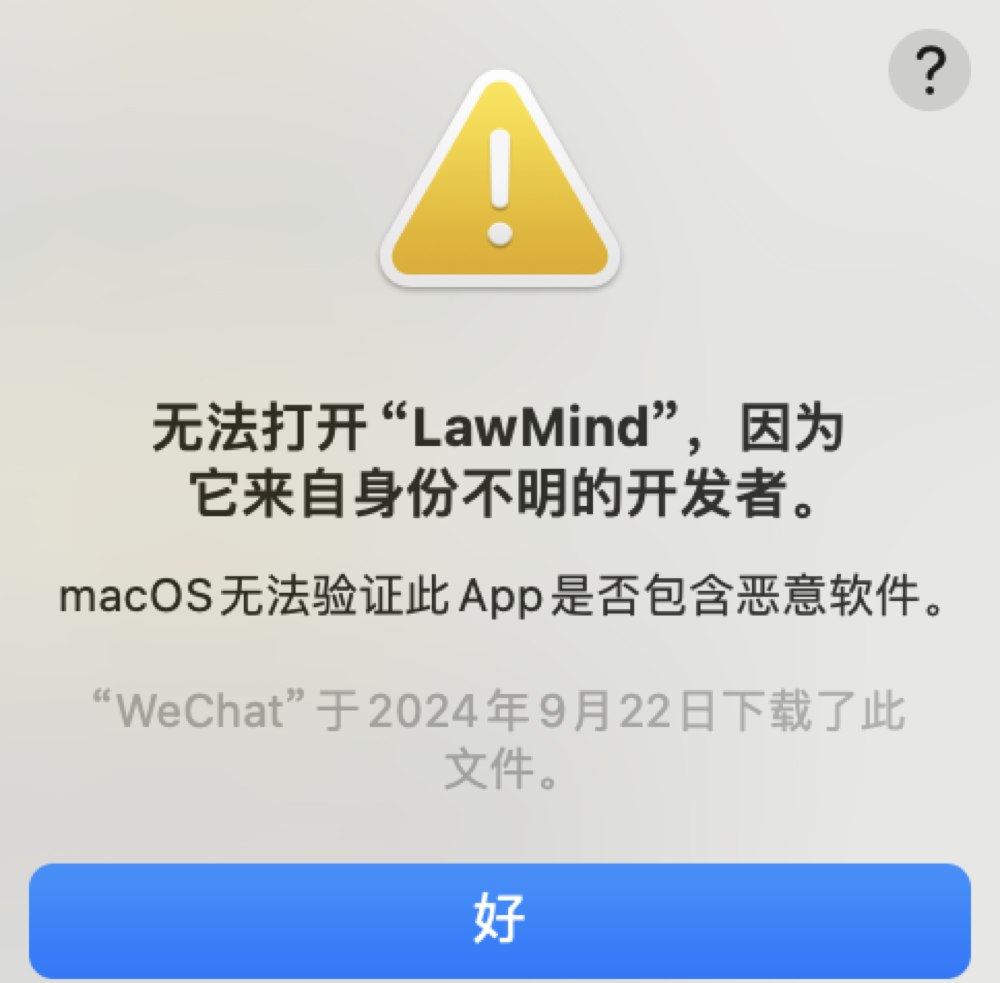
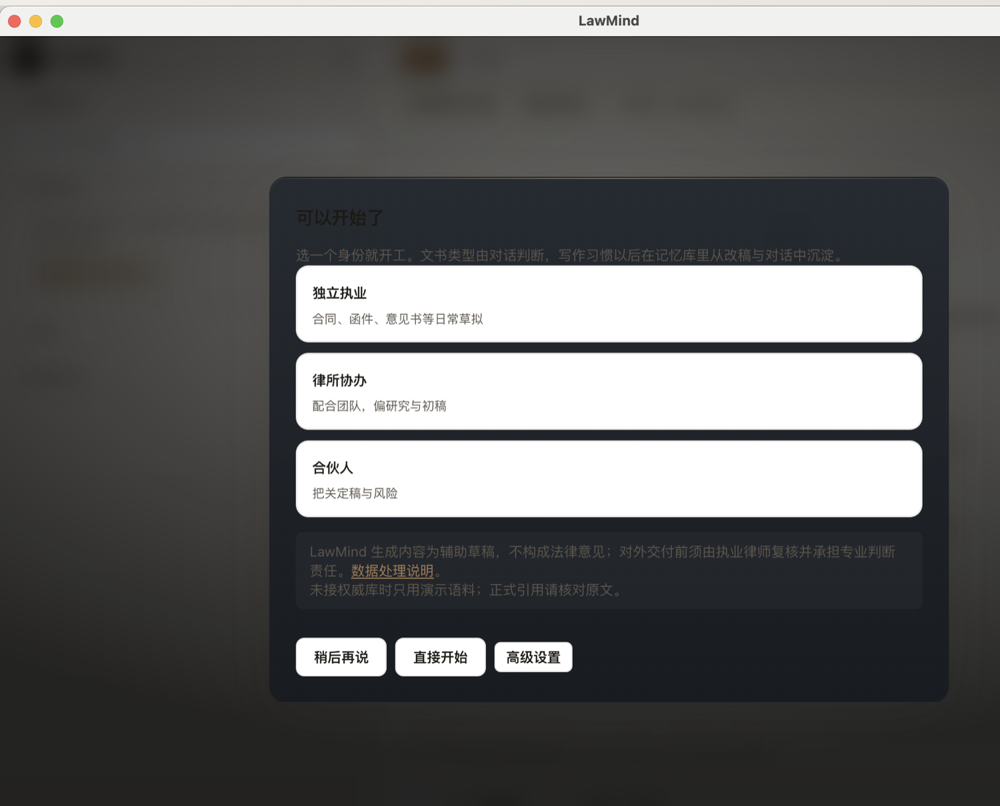
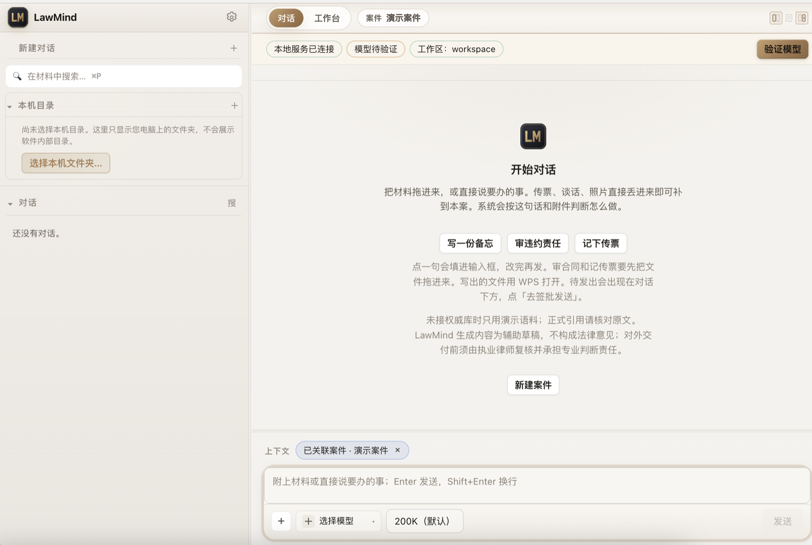

# LawMind 安装说明（Mac 版）

这个安装包只适用 Apple 芯片的 Mac（M1 / M2 / M3 / M4）。里面已经配好了 DeepSeek 的密钥，装完打开就能对话，不用自己申请 API Key。

有一点先说清楚：软件还没做苹果的开发者认证，所以第一次打开时 macOS 会拦一下，需要你在系统设置里手动放行一次。只做这一次，之后都正常。这个包我在自己的 Mac 上装过一遍，能正常启动、能正常对话。

## 一、先确认电脑能不能用

点屏幕左上角的苹果菜单，选「关于本机」，看「芯片」这一行。

写着 Apple M1、M2、M3、M4 的，继续往下看。写着 Intel Core 的，这个包装不上，请找发你文件的人另要 Intel 版。

## 二、安装

### 1. 把安装文件存下来

在聊天窗口点这个安装文件，按提示打开，或者选「在访达中显示」，再在文件夹里双击 `LawMind-0.2.3-mac-arm64.dmg`。

等几秒，会弹出一个窗口，左边是 LawMind 的图标，右边是一个「应用程序」文件夹：

### 2. 把 LawMind 拖进「应用程序」

按住左边的 LawMind 图标，拖到右边的「应用程序」文件夹上松手。等它复制完，大概十几秒。

拷完以后，在「访达 → 应用程序」里就能找到 LawMind。

### 3. 第一次双击打开

打开「应用程序」文件夹，双击 LawMind。这时会弹出下面这个框：

点「好」。这个框里只有「好」一个按钮，没有「打开」，不是你找错了。

出现这个提示跟文件本身没有关系。苹果对没有付费做开发者认证的软件，一律这样拦一次，关掉就行，下一步再去系统里放行。

### 4. 在系统设置里放行一次

点左上角苹果菜单 →「系统设置」，左边选「隐私与安全性」，右边往下滚。

会看到一行关于 LawMind 被阻止的提示，右边有「仍要打开」。点它，输入开机密码或用 Touch ID，再在弹窗里点「打开」。

如果没看到这一行，回「应用程序」再双击一次 LawMind，然后回来看，这一行就出现了。

macOS 14 和更早的系统，也可以直接右键点 LawMind →「打开」→ 在弹窗里再点「打开」，效果一样。

### 5. 选一个身份，进入主界面

LawMind 启动后会问你的工作方式（独立执业 / 律所协助 / 合伙人）。随便选一个，点「直接开始」。这一步不需要填任何 Key。

进去以后，左上角显示「本地服务已连接」，就说明装好了：

### 6. 发一句话试试

在底部输入框里打一句话，比如「用一句话说明什么是不可抗力」，按 Enter。

十几秒内出回答，就一切正常。顶栏那个「模型待验证」只是个提示标签，不影响使用；想验证的话点一下「验证模型」也可以，不点照样能聊。

> 
