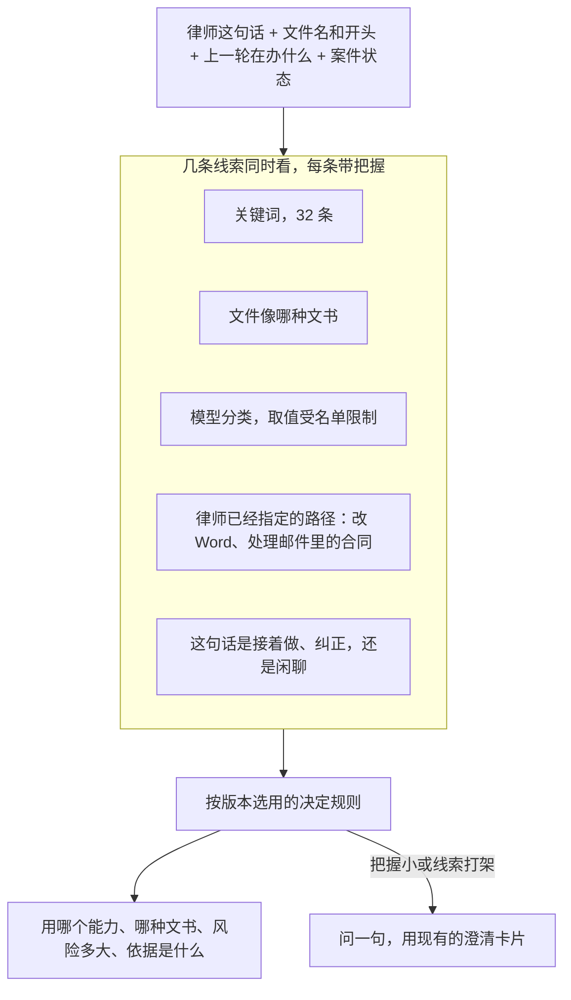

# 怎么让 LawMind 交出来的文书更好

- 日期：2026-10-17
- 依据：[`docs/LAWMIND-CODE-AUDIT.md`](./LAWMIND-CODE-AUDIT.md) 第二部分、[`docs/LAWMIND-HARDCODED-CATALOG.md`](./LAWMIND-HARDCODED-CATALOG.md)
- 这份是改法说明，**还没改代码**。文件位置以当天代码为准。
- 文末附录 A 是核对过的代码位置，附录 D 是改稿时改过的错处。

## 先看结论

交出来的文书不好用，主要不是模型不够强，是分工反了：**该模型判断的事交给了规则，该规则兜底的事又没兜住。**

具体是三件事叠在一起：

1. 写文书时先套一套死标题，模型只能在标题下面填空。填不出来就退回一堆 `【出租人姓名/名称】`。
2. 「这是什么活」靠关键词定死。已经写好的模型分类几乎用不上，类型定错后面全跟着错。
3. 喂给模型的案件和材料被切得很短。合同中间的违约、解除条款经常被切掉。

改的顺序不能乱：

1. 先做一套能打分的检查（否则改了也不知道有没有变好）。
2. 再改「这是什么活」的判断。
3. 再改文书怎么写。
4. 最后改喂给模型的材料。

顺序反了，前面的错会把后面的改进吃掉，而且看不出是哪一处起的作用。

**建议先做的一件事**：搭评测，不改产品行为。目录、数据格式和第一周要交什么，写在第 12 节。

## 这份说明怎么读

| 你想知道             | 看哪             |
| -------------------- | ---------------- |
| 问题出在哪           | 第 1 节          |
| 怎么判断改好了       | 第 2 节、第 7 节 |
| 文书怎么写           | 第 3 节          |
| 「这是什么活」怎么判 | 第 4 节          |
| 材料怎么喂给模型     | 第 5 节          |
| 几周做完、先做哪三件 | 第 6 节          |
| 别人怎么做的         | 第 9 节          |
| 代码在哪一行         | 附录 A           |

---

## 1. 问题出在哪

### 1.1 现在谁在做判断

| 这件事                                 | 现在谁做                     | 代码在哪                                             | 应该谁做                             |
| -------------------------------------- | ---------------------------- | ---------------------------------------------------- | ------------------------------------ |
| 这是起草、审查还是检索                 | 32 条关键词，先中哪条算哪条  | `src/lawmind/router/keyword-route.ts:30-140`         | 关键词给线索，模型做判断             |
| 具体是哪一种文书                       | 61 个分支、70 处正则         | `src/lawmind/router/deliverable-meta.ts:65-290`      | 同上。模型输出格式里现在没有这个字段 |
| 用哪套能力、哪条流水线、哪几份作业标准 | 规则链，全程没有模型         | `src/lawmind/intent/compile-intent.ts:540-765`       | 模型给结论，并写出把握有多大         |
| 文书分几节、每节写什么                 | 21 个写死的章节函数          | `src/lawmind/reasoning/keyword-draft.ts:414-1050`    | 法定格式仍固定；其余由模型拟提纲     |
| 结构够不够                             | 正文里有没有「高风险」三个字 | `src/lawmind/agent/deliverable-shape.ts:97-131`      | 看内容盖没盖住要点；字面检查只作提示 |
| 哪些材料进上下文                       | 固定字数，再留头 65%、尾 35% | `src/lawmind/memory/prompt-windows.ts:28-56,128-133` | 先挑相关段落，再让模型决定还要读哪段 |
| 金额、期限、定金上限                   | 写死的计算表                 | `src/lawmind/litigation/`、`src/lawmind/lint/`       | **不要动**                           |
| 引用能不能对上原文                     | 校验函数                     | `src/lawmind/drafts/citation-integrity.ts:29`        | **不要动**                           |

金额、期限、定金、引用、外发必须律师点「批准发送」、修订格式，这些是底线，不是要拆掉的限制。

### 1.2 三件事会互相加重


判错一次，后面的模板、检查、重写都会跟着错。只改提示词，或者只把字数上限调大，破不了这个圈。

### 1.3 举一个能对上代码的例子

律师说：「把这份租赁合同里的违约金条款改成和民法典一致，再算一下欠租三个月要赔多少。」

1. 句子里有「合同」，关键词把它判成合同审查（`keyword-route.ts:120` 只排除了催告函、律师函）。
2. 文书类型被定成租赁合同或合同审查。
3. 若是合同审查，就套上固定的 13 个栏目（`keyword-draft.ts:920-1015`）。
4. 模型被要求「沿用这些标题，不要整表丢掉」（`model-draft.ts:139`）。
5. 赔偿金额本来可以交给计算工具 `calculate`（参数 `op` 为 `litigation_fee`），但这一轮已经被绑成「审查」，模型只好自己口算。
6. 交稿时如果正文里没有「高风险」三个字，还会被要求重写。

一次判错，后面六步都偏了。

---

## 2. 先做能打分的检查

### 2.1 为什么必须先做

仓库里有 1,095 个测试文件，主要测的是接口、工具、状态对不对。质量方面不是一片空白：`evaluation/human-baseline.ts` 能做律师盲比，`true-manuscript-gate.ts` 和 `lawyer-scorecard.ts` 里也有「第一次就过」的记录。

缺的是日常能用、能指出「漏了哪一条」、能挡发布的检查。现在改提示词，只能靠看几份稿子的感觉。感觉在这类系统里很不可靠：一次改五处，变好了不知道是哪一处，变差了也不知道退哪一处。

### 2.2 怎么打分

不要用「满分 5 分、各项平均」。一份尽调备忘录抓住了 95% 的问题、漏掉一条重大风险，它不是 95 分，它不能发出去。这个说法来自 [Harvey 的评测说明](https://github.com/harveyai/harvey-labs/blob/main/docs/eval-strategies.md)（2026）。

做法：

- 每条检查只有「过」或「不过」。
- 一个任务所有检查都过，才算这个任务过。
- 另外记下「过了几条 / 一共几条」，用来看还差多远，不拿来当质量分。

检查分成六组，只用来归类，不加权平均：

| 看什么         | 具体问什么                                   | 对应原来的问题编号 |
| -------------- | -------------------------------------------- | ------------------ |
| 要点齐不齐     | 这种文书该写的内容有没有写到                 | F2、F4             |
| 对不对         | 结论、法条、金额、期限对不对                 | 底线               |
| 对得上原文吗   | 事实和法条能不能指回来源                     | 底线               |
| 结构合适吗     | 分节能不能帮律师看这份文书，而不是为了凑标题 | F4、F8             |
| 能直接改吗     | 律师是改几个字，还是得重写                   | F12                |
| 风险写清楚了吗 | 有没有指出风险、分清轻重、给出做法           | F8                 |

[LEGIT（ACL 2026）](https://aclanthology.org/2026.acl-long.150/) 也是把「问题有没有覆盖到」和「结论对不对」分开打，而且和律师标注对得上。不要合成一个总分。

### 2.3 谁来打分

| 事项               | 做法                                                                   | 为什么                                                                                                                                                                                                                 |
| ------------------ | ---------------------------------------------------------------------- | ---------------------------------------------------------------------------------------------------------------------------------------------------------------------------------------------------------------------- |
| 用哪两个模型打分   | 两家不同公司的模型各打一遍，取平均。两家都判「全过」才算严格通过       | [Harvey 的默认做法](https://github.com/harveyai/harvey-labs/blob/main/docs/eval-strategies.md)是两个模型分开打。[Play Favorites（2025）](https://arxiv.org/html/2508.06709) 说明：自己家的模型给自己家的稿子打分会偏高 |
| 随机性             | 温度设为 0，尽量每次结果一样                                           | Harvey 的要求                                                                                                                                                                                                          |
| 怎么比对           | 看意思，不用关键词匹配                                                 | 同一件事换种说法也该算过                                                                                                                                                                                               |
| 左右谁先出现       | 两份稿子左右对调再判一次。两次结论不一样，记成平局                     | [Judging the Judges（2025）](https://aclanthology.org/2025.ijcnlp-long.18.pdf)                                                                                                                                         |
| 看哪些文件         | 每条检查只看它声明的那份文书                                           | 避免一份备忘录的内容影响另一份合同的判断                                                                                                                                                                               |
| 律师抽查           | 先抽 40 份让律师标。两人意见一致程度低于 0.6，先改检查项，不改产品代码 | 仓库里已有 `evaluation/llm-review.ts` 的一致率计算，门槛是 0.8                                                                                                                                                         |
| 要不要标准答案全文 | 不要。检查项自己写清「怎样算过」                                       | 省掉维护标准稿的成本                                                                                                                                                                                                   |

### 2.4 要多少例子

「全过」的底子通常不到一半。想看出提高 10 到 15 个百分点，每组大约要一两百个任务。下面是粗算（两边各一组、显著性 0.05、把握 0.8）：

| 现在全过的比例 | 改完想达到 | 每组至少多少任务 |
| -------------- | ---------- | ---------------- |
| 20%            | 35%        | 约 135           |
| 20%            | 30%        | 约 291           |
| 40%            | 55%        | 约 170           |
| 50%            | 65%        | 约 167           |
| 60%            | 70%        | 约 353           |

不要以为「提高 15 个百分点，几十个例子就够」。从 50% 到 65%，大约要 167 个，不是 87 个。

建议规模：**200 到 300 个任务**。27 种文书每种 6 到 12 个，每个任务 8 到 15 条检查，一共大约 2,000 到 4,000 条。Harvey 公开基准是 2,010 个任务、约 11.4 万条检查。我们这个规模够内部决定能不能发，不够拿出去说「行业基准」。

任务从哪来：

- 六成用脱敏后的真实件（扫描件、批注、文件名很乱，这些都要留着）。
- 三成用编出来的边界情况：没材料、特别长、事实互相打架、中英混杂。
- 一成从手册第 29 章的 23 个旧故障里各抽一例。

### 2.5 放在哪、什么时候跑

- 代码放 `src/lawmind/evaluation/deliverable-gate/`，题目放 `fixtures/deliverable-gate/`。
- 能接着用的现成代码：`evaluation/golden.ts`、`quality-seed.ts`、`llm-review.ts`、`human-baseline.ts`、`true-manuscript-gate.ts`、`lawyer-scorecard.ts`。新写的是检查项格式、两个模型打分、以及「全部通过才算过」。
- **不要放进每次提交都跑的测试。** 贵，而且打分模型会变。放进发版检查 `pnpm lawmind:verify:release`，再加每周定时跑。日常提交只跑不用模型的检查：引用、金额、法定栏目在不在。
- 每次结果写成 `scores_dual.json`：两个模型各一份，再加上平均。界面上显示「全部通过」或「还差 N 条」。

现成工具，不必自己从零写打分器：

- [`promptfoo`](https://github.com/promptfoo/promptfoo)（MIT）：用配置文件写检查项，支持两个模型投票。适合先跑通。
- [`DeepEval`](https://github.com/confident-ai/deepeval)（Apache-2.0）：写法像 pytest，适合放在 Python 侧。
- [`Inspect AI`](https://github.com/UKGovernmentBEIS/inspect_ai)（MIT）：适合要真实跑工具的题目。
- [Harvey 的评测仓库](https://github.com/harveyai/harvey-labs) 看方法，不抄题目。检查项字段可以照它的 `criteria`、`match_criteria`、`deliverables`。

---

## 3. 文书怎么写

### 3.1 模板分三档，不要一刀切

不能把所有死标题都改成「仅供参考」。有的文书法律就规定了栏目，有的是律所自己的写法。全交给模型自由发挥，等于拿不确定替换确定。

| 哪类文书     | 结构怎么处理                                                         | 例子                                              |
| ------------ | -------------------------------------------------------------------- | ------------------------------------------------- |
| 法律定了格式 | 栏目固定，模型只写内容。缺了就拦住导出                               | 起诉状（《民事诉讼法》第 122 条）、答辩状、上诉状 |
| 所内常用模板 | 默认用模板。模型可以改顺序、合并、删节，但要写明改了什么，并记进审计 | 合同、律师函、备忘录、尽调报告                    |
| 没有固定格式 | 只给「必须写到的要点」，栏目由模型定                                 | 研究报告、ESG、内部备忘、给客户的问答             |

做法：在文书规格上加一个字段，取值只有三个：`fixed`（定死）、`template`（默认可改）、`free`（自拟）。`keyword-draft.ts` 里那 21 个章节函数先留着，按这个字段决定它们是唯一结构、默认结构，还是举例。

这些函数不能删。没网、没密钥、模型超时的时候还得靠它们。它们也是核对模型输出的另一套眼睛：模型和规则都错，才是真错；只剩一边，错了发现不了。

可以参考的写法：

- [STORM](https://github.com/stanford-oval/storm)（2024）：先调研，再写分层提纲，再按节填，最后润色。和「先给提纲再写正文」的基线比，结构更清楚的比例高 25 个百分点，覆盖更全的比例高 10 个百分点。LawMind 已有提纲机制，但没覆盖 ESG 和一般报告（见 3.4）。
- [Open Deep Research](https://github.com/langchain-ai/open_deep_research)（2025–2026）：先问清范围，再拆成几个小题目分头查，压缩结果后由主模型写成一篇。材料太长就截短重试。报告可以分头查，但成稿必须由主模型写，不能靠模板拼。

### 3.2 让模型分类时必须填「是哪种文书」

这是性价比最高的一处改动。模型分类的输出格式在 `src/lawmind/router/model-route.ts:49-67`，只有任务大类、摘要、风险、用哪个模型、要不要确认、输出格式。**没有「是哪种文书」，也没有「用哪个能力」。** 后面 `deliverable-meta.ts:576-584` 还会用正则结果盖掉已有类型。于是规格、章节、验收、审稿全建立在正则上。

改成下面这种，而且「只能填这几个值」：

```ts
{
  (kind, // 8 种任务大类，已有
    deliverableType, // 27 种文书，必须从规格表生成
    capabilityId, // 23 个能力，必须从能力表生成
    structurePolicy, // fixed / template / free
    confidence, // 0 到 1，把握多大
    evidence, // 一句话理由，写进审计
    riskLevel,
    requiresConfirmation,
    output);
}
```

这三个列表必须从同一处生成，不能手写两份：

- 文书类型的类型定义：`src/lawmind/types.ts:51-77`，26 个具体名字。
- 规格对象：`src/lawmind/deliverables/registry.ts:488-501`，10 个具名规格 + 16 个日常文书规格 + `document.general`，一共 **27** 个。
- 能力名单：`src/lawmind/skills/lawyer-capability-lock.ts:7`，23 个。

**动手前先修一个对不上的地方。** `review.table`（审查表）在规格表里，却不在上面那个 26 个名字的类型里，现在靠一个很宽的字符串类型兜着。如果新格式按类型定义生成，审查表会被漏掉，路由结果变成「不认识」。这个不一致不先修，新格式一上线就会错。

还有一个边界要说清。自己部署、用 [xgrammar](https://github.com/mlc-ai/xgrammar) 这类工具时，可以在抽词时禁止非法取值。买来的模型接口通常只保证「格式合法、取值在名单里」，不保证「选对了」。所以加上格式约束之后，仍然要靠第 2 节的评测和第 4 节的分歧处理来发现选错。

[BAML](https://github.com/BoundaryML/baml) 的写法值得看：每个取值旁边写「什么时候选它」。这比在提示词里堆规则好维护。和现有 zod 怎么接，实施时再定。

### 3.3 结构检查看内容，不看有没有某三个字

现在缺「高风险」或「下一步」这几个字，就会逼模型重写。备忘录的注入在 `turn-orchestrator-model-loop.ts:1319-1333`，诉状和追问清单在 `:1290-1318`。模型很快就会学会把这几个字塞进去，正文却没变好。

这不是一道总开关，是三套分开的检查：

- 备忘录：`missingMemoSections`，而且只有当这句话被认定是在要备忘录时才跑（`deliverable-shape.ts:180-189`）。
- 诉状：`pleadingSectionGaps`。
- 追问清单：`consultListNeedsRewrite`（少于 8 条就要求重写，见 `:18`）。

三套要分开改。

改法：

1. 新增 `src/lawmind/deliverables/coverage-judge.ts`。输入是「这种文书必须写到的要点」和正文。输出是每一条：写到了、写了一部分、没写到，并给出依据原句和位置。一次调用可以判 10 到 20 条。
2. 原来的字面检查留着，但只出现在报告和界面提示里，**不再逼着重写**。
3. 法律要求必须有的栏目仍然可以拦住导出，但判断方式改成「意思到了就算」，不要死抠某一个词。

审稿里的确定性检查继续做当事人是否一致、定金是否超过 20%、利率倍数、日期顺序。新的覆盖检查只看「要点写没写到」。两套不互相替代。

### 3.4 研究报告不要绕开主模型

现在的情况：

- `deliverable-pipeline.ts:12-17` 把 ESG、一般报告、合规报告、学习报告设成「自动跑完整条旧流水线」。
- `research-draft-gates.ts:33-37` 里，要先出提纲的只有合规报告、学习报告、培训课件。
- **ESG 和一般报告两边都没沾上提纲，又绕开了主模型**，直接跑旧流水线。

最需要判断的报告，路径最短，主模型根本没参加。

两步改：

1. 马上把自动流水线的默认值关掉。`deliverable-pipeline.ts:30-44` 现在默认开，环境变量 `LAWMIND_AUTO_DELIVERABLE_WF` 设成 `0` 或策略里关掉才会停。先改默认值，一行就能退回。
2. 然后让这四类报告走正常对话。ESG 和一般报告也要先出提纲：模型拟提纲，低风险可以自动往下写，高风险等律师看一眼，再按节写成稿。
   - 按节写比一次写完全文好：每节有自己的材料和引用，后半篇不容易空。
   - `execute_workflow` 留着，但是模型可以调用的工具，不是旁路。

Open Deep Research 的「分头查、压缩、再由主模型成稿」可以直接借。材料超长时逐步截短重试，也可以用来做失败兜底。

### 3.5 写失败了要说失败，不要交一份空壳

`model-draft.ts:221-243`：模型没写成，就退回骨架。骨架里是 `【出租人姓名/名称】` 这种空位，并加一句「不能当作成稿外发」。问题是这份东西**仍然会接着往下走，看起来像一份文书**。

改成四步，一步比一步重：

1. 用当前模型写。
2. 只指出内容缺了什么，再写一次。不批评标题好不好看。
3. 换更强的模型，或放宽输出长度，再试一次。
4. 还是不行：标成「不能外发」，禁止导出。界面给两个按钮：「重试」和「先只出提纲」。

不要在失败时悄悄交出一份满是空位的稿子。空壳比一句「这次没写成」更危险。

「先批评再改」有用，但批评的必须是内容和事实，不是格式。格式批评只会让所有稿子长得一样。这个结论来自 Self-Refine（2023）和 CRITIC（2024），年份早一些，但和现在看到的现象一致。

---

## 4. 「这是什么活」怎么判断

### 4.1 不要用模型替换规则，把两边都留下

最初的想法是：模型做唯一入口，规则只在模型挂了的时候顶上。对照 [vLLM Semantic Router](https://github.com/vllm-project/semantic-router)（2025 年 9 月发布，2026 年 9 月到 0.4）之后，改成下面这样更合适。它不是「用模型换掉规则」，而是把几种线索拼成可以配置的决定：关键词、语言、上下文长度、角色这些很快的线索，加上领域分类、相似度、事实是否站得住这些慢一点的判断。

为什么更合适：

1. 关键词、文件名、案件状态、上一轮在办什么，又快又便宜，不该删。
2. 每次判断都能写出「中了哪几条线索、按哪条策略定的」，事后查得着。
3. 个人版和律所版可以用同一套线索、不同的策略。比如律所版把握不大就先问一句。



要点：

- 「改这份 Word」「处理这封邮件里的合同」不是猜出来的类型，是律师已经指定了路径。这两条优先级最高，中了就不用再叫模型。
- 现在模型和关键词不一致时，只记下来，不改变结果（`route-divergence.ts:82` 默认开，`:296` 默认只记录）。要改成按版本处理：个人版信模型，律所版先问，私有化部署可配。
- 每次决定写一条审计：中了哪些线索、模型把握多大、用了哪条策略、有没有分歧。

把握多大不要拍一个 0.7。[semantic-router 1.x](https://github.com/aurelio-labs/semantic-router) 可以把原始分数校准成真正的概率。阈值放在评测集上拟合。

### 4.2 四处仍在绕开模型分类

`routeAsync`（带模型的分类）目前只在 `src/lawmind/engine/planning.ts:32` 被调用。下面四处仍直接用关键词：

| 位置                                                               | 现在                         | 改成                                 |
| ------------------------------------------------------------------ | ---------------------------- | ------------------------------------ |
| `src/lawmind/agent/tools/lawmind-deep-research.ts:13`              | 直接按关键词分类             | 走统一的决定                         |
| `src/lawmind/agent/tools/engine/engine-pipeline-tools.ts:34,75-79` | 从旧产物反推类型             | 读已经存下来的判断；没有才走统一决定 |
| `src/lawmind/agent/deliverable-pipeline.ts:6,23`                   | 关键词决定是不是要出正式文书 | 和第 3.4 节一起停掉这条旁路          |
| `src/lawmind/router/intake-gate.ts:13,103`                         | 关键词生成要问律师的问题     | 模型来问，关键词只做备用             |

### 4.3 上一轮的判断会不会粘住

最初以为上一轮的能力会无条件带到这一轮。代码不是这样。`compile-intent.ts:711-723` 已经有四道条件：这句话得是在接着做、不是在纠正、不是要写诉状、也没有命中更专门的信号，才会沿用。

真正的缺口是：

1. 沿用时把握写死成「中等」，不看新证据，也不和模型的判断比。
2. 换了能力没有记录。审计里看不出为什么换，律师也不知道这一轮换了做法。
3. 一旦命中专门信号，沿用就完全失效。律师说「接着刚才那份合同继续」，有时不该因此被打断。

改动保持很小：

- 沿用时写清依据：是连续第几轮，还是模型和规则判成同一个。
- 增加一条 `capability_rebound` 记录：从哪个能力换成哪个、为什么、把握多大。界面用一句话提示「这一轮改按某某处理」。
- 四道条件先不动。只把「命中专门信号就禁止沿用」改成「可以沿用，但把握降一档」。

### 4.4 别让分类变贵、变慢

一次分类大约 500 到 1,500 个 token。用这些办法压住：

| 办法         | 怎么做                                                 | 效果               |
| ------------ | ------------------------------------------------------ | ------------------ |
| 能短路就短路 | 律师已指定路径、文件类型明确、和上一轮相同，直接出结果 | 多数轮次不用叫模型 |
| 缓存         | 用「这句话 + 文件指纹 + 上一轮能力」做键               | 重复的话不再花钱   |
| 用小模型     | 用已有的 `workerModelId`（`models/custom-store.ts`）   | 费用降一个量级     |
| 并行         | 和读会话、读策略同时进行                               | 律师感觉不到多等   |
| 先只记录     | 新策略先跑一两周，只记「如果按新规则会怎样」           | 出问题可以马上退回 |

RouteLLM（2024）说明：负责分流的模型本身必须小，才能在质量差不多的时候把费用降下来。

### 4.5 怎么算改好了

| 看什么               | 现在                             | 目标                        | 用什么测                         |
| -------------------- | -------------------------------- | --------------------------- | -------------------------------- |
| 能力判对的比例       | 已有 75 个标准例子，还没测出基线 | 至少 90%                    | `src/lawmind/intent/gold-set.ts` |
| 文书类型判对的比例   | 还没测                           | 至少 85%                    | 同一批例子补上标签               |
| 判错后律师重做的比例 | 还没测                           | 下降三成                    | 换能力的记录，加上律师重说一遍   |
| 分类多出来的等待     | —                                | 最慢的那 5% 不超过 300 毫秒 | 现有的分阶段计时                 |
| 分类多出来的费用     | —                                | 不超过一整轮 token 的 8%    | 用量账本                         |

---

## 5. 喂给模型的材料

### 5.1 不是「多给一点」就好

最初想把起草时的案件和材料额度提高一个数量级。外部结果并不支持「越长越好」：

- [Context Rot（2025）](https://www.trychroma.com/research/context-rot) 和 [NoLiMa（2025）](https://proceedings.mlr.press/v267/modarressi25a.html) 都说明：上下文变长以后，靠意思找信息、要连几步推理的任务会变差。其中「3.2 万 token 时，11 个模型掉到短上下文成绩的一半以下」是 NoLiMa 的数字，不要安到 Context Rot 头上。
- 2026 年 6 月有一项事先登记的对照实验，在 15 万 token 以内没有复现「只是变长就会变差」。所以变差和任务、模型有关，不是自动发生。
- [U-NIAH（2026）](https://dl.acm.org/doi/full/10.1145/3786609) 更接近我们要做的事：检索进来的噪声、段落顺序，会明显拖累效果。他们的实验里，先检索再回答，整体胜过把长文直接塞进去，胜率约 82.58%。

所以额度不是越大越好。要先挑相关的，再把最相关的放在开头和结尾。只把上限调大、不筛选，会更差。

### 5.2 先修一个单位用错的地方

`turn-orchestrator-prompt.ts:421` 按字符截断案件索引。`:515` 又把**同一个数**当成 token 上限。中文里一个字大约一个 token，所以暂时没爆。一旦按 token 调，就会偏。

改成统一用 token。估算用 `agent/context-budget.ts:58-84` 里已经写好的中文算法，不要简单除以 4。`prompt-fragments.ts:50` 的 `matter_index` 上限也是 1,600，和字符帽是同一个数，两处要一起改。

### 5.3 闲聊和起草不要用同一套额度

起草需要的材料比闲聊多很多。「这一轮要不要出文书」在回合开始时就已经知道，不用新逻辑。

| 内容                         | 现在（按 12.8 万 token 的窗口）     | 闲聊       | 起草                                              |
| ---------------------------- | ----------------------------------- | ---------- | ------------------------------------------------- |
| 案件索引                     | 1,600 字符，还被当成 token 用       | 保持 1,600 | 窗口的 8% 左右，大约 1 万 token，而且先按要点筛选 |
| 派生事实、改稿范例、好稿范例 | 三样加起来 660 token                | 保持       | 窗口的 12% 到 15%，三样分开设上限                 |
| 律师和客户的简况             | 各 800 字符                         | 不变       | 各 1,500                                          |
| 作业标准                     | 正文最多 2 篇；索引上限 2,000 token | 保持 2 篇  | 全部篇目各留一行简介，模型再自己选 3 到 4 篇全文  |

起草的额度提高，必须和第 5.4 节的筛选一起做。只放大、不筛选，就是第 5.1 节说的那种变差。

### 5.4 按条款挑，不要按头尾切

现在是留开头 65%、结尾 35%（`prompt-windows.ts:128-133`）。合同里违约、解除、争议解决常常在中间，而模型对中间最不敏感。

改成四步：

1. 按标题和条款号切开，不按字数切。
2. 用现有的全文检索（`src/lawmind/indexing/`）按这种文书要看的要点去找。审合同就找违约、赔偿、解除、管辖；写诉状就找事实、证据、请求权。
3. 最相关的放开头和结尾，次相关的放中间。
4. 放不下的部分留下目录和「继续读」的工具，让模型自己决定要不要读。

可以参考：

- [Anthropic 的 Contextual Retrieval（2024）](https://www.anthropic.com/engineering/contextual-retrieval)：每个片段前面加 50 到 100 个 token，说明它在整份文件里的位置，再建检索。配合重排序，检索失败大约少 67%。每个片段要调用一次模型，入库会贵，长文件可以先做摘要或批量处理。
- [`rag-production-stack`](https://github.com/numoru-ia/rag-production-stack)（2026）：按意思分块，再混合关键词和向量，最后重排序，只留 6 段。LawMind 已有全文检索，可以先做混合检索加重排序，不必先上新的向量库。
- [`rag-agent-harness`](https://github.com/mallahyari/rag-agent-harness)（2026）：检索做成工具，还能把相邻段落一起取出来；有硬性 token 上限；引用必须对得上真正取回的片段，对不上就拒掉。这正是「模型点名要深读哪一段」。

### 5.5 一份材料不要只看头尾 3,000 字

`material-pile-digest.ts`：一次最多 32 份（`:28`），每份只给模型 3,000 字（`:31`），卡片摘录 160 字（`:32`）。两万字的合同，违约责任在中段，正好在窗外。

改成两段：

1. 第一段不用大模型。每份文件抽出：标题、定义过的术语、条款号和每条第一句、金额、期限、当事人。一份几百个 token。
2. 第二段交给模型。它看着所有摘要，点名要深读哪些文件的哪些段，再对那几段做摘要。
3. 卡片要长到能写下要点和出处，不要卡在 160 字。
4. 卡片里的每条要点必须能指回原文位置，指不回就丢掉。做法照 `rag-agent-harness` 的引用校验。

Chain-of-Note（2023）说明：先判断相不相关再回答，比把噪声一起喂进去更稳。U-NIAH（2026）说明检索噪声会拖后腿。关键是拿掉无关文字，不是多给。

### 5.6 作业标准：先给目录，再让模型自己选

现在 `skill-prompt-budget.ts:56-58` 写死只放 2 篇正文。索引上限 2,000 token（`prompt-fragments.ts:55`）。`read_skill` 再截到 12,000 字符（`read-skill-tool.ts:20,102-110`），而且没有「下一页」。长的作业标准永远读不全，模型还不一定知道被截断了。

[Anthropic 的 Agent Skills（2025 年 10 月）](https://www.anthropic.com/engineering/equipping-agents-for-the-real-world-with-agent-skills) 把一份技能分成三层：

| 层  | 放什么           | 花费                                 |
| --- | ---------------- | ------------------------------------ |
| 1   | 名字和一句话说明 | 每篇大约 100 token，一直放着         |
| 2   | 正文             | 用到才读，建议少于 5,000 词          |
| 3   | 附带参考和脚本   | 需要才读；脚本只把运行结果放进上下文 |

他们的经验是：同时启用的技能超过 20 到 50 个，就该分组，不要一次全打开。

对应到 LawMind：

- 37 篇各一行简介大约 550 到 800 token，可以全部放着。现在的问题不是索引太长，是正文只挑了 2 篇。
  **实测（2026-10-24）**：绑定回合要进索引的行组最宽 581 字符（旧计划）/ 479 字符（新计划），帽是 2,000 token —— 索引从来不是瓶颈。
- 让模型看着全部简介，自己选 3 到 4 篇全文，并把选择理由记下来。不要再只靠人工表 `PRIMARY_BY_CAPABILITY`。
  **已改**：不再按人工表固定 2 篇，改为注入阶段表点名的正文，其余整篇降级为索引行。
  不做「让模型先选」的一次额外调用，也不把引用/效力/要素三篇当成每轮必灌的检查表。
- `read_skill` 改成可以接着读下一段，去掉 12,000 字的死上限。或者把长文拆成正文加参考文件。
  **已做（2026-10-24）**：去掉死上限，改为按 `##` 分节 + `section` 按名取用，不截断、切不到半句；未读的节在正文里具名列出。分节是「正文 + 参考」在本仓的等价物——`references/` 目录不在发行包里，一节就是一次按需读取的单位。
- 模型没选的时候，仍按能力默认放 2 篇，避免一轮里一篇作业标准都没有。
  **已改**：现在保底是「本阶段技能」那一组；一个绑定了能力的回合不会再出现一篇正文都没有。
- ⚠️ 顺带修正一处：固定 2 篇时 `contract.review` 的两篇正文已是 2,395 token，超过 `skill_index` 的
  2,000 帽，`capFragmentBody` 一直在按字符腰斩 Playbook。现在 `capTokens = max(基准帽, 实测量)`，
  以「不切半篇」为硬条件，帽不再是取舍工具。

---

## 6. 按周做，一次只动一处

### 6.1 时间表

| 周              | 做什么                                                     | 开关                                        | 怎样算过                                                                 | 怎样退回                     |
| --------------- | ---------------------------------------------------------- | ------------------------------------------- | ------------------------------------------------------------------------ | ---------------------------- |
| 第 0 周         | 200 到 300 个任务、检查项、两个模型打分、律师抽 40 份校准  | 不影响产品                                  | 两人意见一致程度至少 0.6；两个模型一致率至少 0.8                         | —                            |
| 第 1 周         | 关掉报告自动流水线；模板分三档；写失败就明确失败           | `autoDeliverableWorkflow`、`reasoning.mode` | 「全部通过」的比例不下降；结构合适的比例提高 15 个百分点                 | 改回默认值                   |
| 第 2 周         | 线索加策略的判断；输出格式补上文书类型；沿用时补记录       | `router.mode`、`divergence.posture`         | 能力判对至少 90%，文书类型至少 85%                                       | 关掉模型这条线索，回到关键词 |
| 第 3 周         | 起草和闲聊分开额度；按条款挑选；材料两段摘要；技能给全目录 | `context.preset`，每项单独的环境变量        | 第一次交稿后返工少三成；引用不下降                                       | 逐项改回默认                 |
| 第 4 周         | 用内容覆盖替换字面重写；报告补上提纲                       | `coverage.judge`                            | 只为了凑标题而触发的重写降到 0。法律要求的栏目仍可拦住导出，这个数不清零 | 关掉开关                     |
| 第 5 周（可选） | 用 DSPy/GEPA 改写分类和起草的提示词                        | 离线                                        | 在没参与调参的题目上超过手写提示词                                       | 留着旧提示词                 |

一次只动一组。不是求稳，是为了知道是哪一处起的作用。

### 6.2 先只记录，再真正切换

新的判断策略、新的覆盖检查、新的额度，都先跑一到两周：只记录「如果按新办法会怎样」，不改变律师看到的结果。分歧稳定后再切换。现有的 `route-divergence.ts` 已经是「只记录」，把它加上「可以切换」即可。

### 6.3 方案自己的风险

| 风险                         | 怎么发现                                | 怎么处理                                                     |
| ---------------------------- | --------------------------------------- | ------------------------------------------------------------ |
| 打分模型一升级，分数整体挪了 | 同一批固定题目，隔周波动超过 5 个百分点 | 留 30 到 50 道永不改的题目，每次必跑；打分模型的版本记下来   |
| 用考题调提示词，分数虚高     | 练习题涨了，留出的题不涨                | 题目分成练习、每周回归、发布三份。发布那份一个季度才打开一次 |
| 律师标注太贵、来不及         | 进度落后                                | 先标 40 份做校准，其余用两个模型，再抽 10% 人工看            |
| 费用涨了                     | 一轮 token 增加超过 15%                 | 能短路就短路，加缓存，分类用小模型；个人版和律所版用不同额度 |
| 判断改完反而更错             | 标准例子的正确率下降，换能力的次数暴增  | 新策略先只记录两周；保留一键回到关键词                       |
| 覆盖检查冤枉人               | 律师说「明明写了，却判没有」            | 这项检查只提示、不拦导出。拦住导出的仍是原来的确定性检查     |
| 报告不再走捷径后变慢         | 最慢的那 5% 比现在慢两成以上            | 分节并行写；提纲可以先返回，正文在后面补                     |

### 6.4 如果只能做三件

1. **关掉报告自动流水线（改一行默认值），再把模板分成三档（大约半天）。** 报告类马上不再绕开主模型。
2. **让模型分类必须填「是哪种文书」（一到两天）。** 这是后面一串错误的源头。动手前先处理 `review.table` 不在类型定义里的问题。
3. **起草和闲聊分开额度，材料改成先摘要、再点名深读（三到四天）。** 模型才能看到完整案件，而不是头尾残篇。

前两件加起来不到三天。

### 6.5 可选：用程序改提示词

评测题有了之后，可以把分类和起草的提示词交给 [DSPy 的 GEPA](https://github.com/stanfordnlp/dspy)（2025–2026）。给它练习题和打分函数（要返回分数和哪里不好），它会改提示词、再跑、留下更好的那版。

只用来改提示词里的说法，比如「什么时候选哪种文书」的说明。不要让它改计算表、输出格式和安全规则。必须留一批它没见过的题，否则是在背答案。

---

## 7. 怎样算改好了

### 7.1 要变好的

| 看什么             | 怎么定义                                       | 目标                 | 需要多少样本                               |
| ------------------ | ---------------------------------------------- | -------------------- | ------------------------------------------ |
| 全部通过的比例     | 所有检查都过的任务占多少                       | 相对提高 15 个百分点 | 每组至少 150 个；两个模型取平均            |
| 单条通过的比例     | 通过的检查条数除以总条数，只作诊断             | 相对提高 12 个百分点 | 同上                                       |
| 律师盲选           | 两份稿子左右随机，不告诉哪份是新的，律师选一份 | 新的至少赢 60%       | 至少 167 次；左右对调再判                  |
| 第一次就能用的比例 | 交出去之后没改就导出的占多少                   | 返工少三成           | 用现有的 `first_pass`、`rewrite_amplitude` |

### 7.2 不许变差的

这些掉了，不管前面的指标涨多少，都退回。

| 看什么             | 目标       | 现有代码                              |
| ------------------ | ---------- | ------------------------------------- |
| 引用对得上原文     | 100%       | `validateDraftCitationsAgainstBundle` |
| 法定计算算对       | 100%       | `labor/`、`litigation/` 的测试        |
| 审稿里的确定性检查 | 不低于现在 | `guardian/machine-verifiers.ts`       |
| 邮件不会自己发出去 | 0 次误发   | 写入待发信，律师点「批准发送」        |
| 特权内容和外发对象 | 不放宽     | `privilege-sentinel`、`content-trust` |

法律产品看的是最差的那一次，不是平均分。

### 7.3 费用和速度

| 看什么                        | 目标                                               |
| ----------------------------- | -------------------------------------------------- |
| 分类多出来的等待（最慢的 5%） | 不超过 300 毫秒                                    |
| 一整轮 token 增加             | 不超过 15%（其中分类本身不超过 8%，见 4.5）        |
| 起草变慢（最慢的 5%）         | 不超过 20%                                         |
| 评测一次要花多少              | 两个模型乘 2,000 到 4,000 条检查，上线前先估一笔账 |

第 4.5 节的 8% 是「分类这一步」占整轮的比例。这里的 15% 是整轮一共允许多出来的比例。两个数不是一回事。

### 7.4 题目本身也要当代码管

题目不是一次性脚本。不管好，半年后没人知道上次那个 62% 是怎么来的。

| 规则     | 做法                                                                           |
| -------- | ------------------------------------------------------------------------------ |
| 分成三份 | 练习（调提示词，可以看）、每周回归（可以看）、发布（一个季度才打开，平时不看） |
| 留版本   | 改检查项或改题目都记版本和改了什么。旧分数必须能按旧版本再算一遍               |
| 固定题   | 30 到 50 道永不改，用来跨版本对比。换打分模型时先跑这批                        |
| 防止泄题 | 发布那份的原文不能出现在提示词、作业标准、示例里。加一条自动检查做字符串比对   |
| 谁写的   | 每条检查记下作者和依据：法条、所内标准，或某次故障                             |
| 不用了   | 标成停用，不要删。删了以后旧分数无法解释                                       |

发布那份的分数只用来决定能不能发，不用来日常调提示词。一旦拿它调，它就变成练习题，发布门就废了。

---

## 8. 不要做的事

1. 不要一次改完五组。涨了说不清是谁，跌了也不知道退哪里。
2. 不要删掉关键词和章节函数。没网、没密钥、模型超时都要靠它们。它们也是核对模型的另一套眼睛。
3. 不要再拿「有没有某三个字」当质量标准。模型会学会把那三个字塞进去。
4. 不要用写稿的那个模型给自己打分。至少换一家公司的模型，最后以律师盲选为准。
5. 不要以为「输出格式限制住了」就等于「判对了」。格式只保证取值合法。
6. 不要为了看起来更自动而再加一批代理。每加一个，就多一套失败和一份上下文。先把判断做对。
7. 不要把 AGPL 的代码贴进产品。[`draft-legal`](https://github.com/AniketTati/draft-legal) 是 AGPL-3.0，只能看思路。下面几个是 Apache-2.0，相对安全，使用前仍要核对仓库里的 LICENSE：[`contract-review-agent`](https://github.com/lowtidebuild/contract-review-agent)、[`PAKTON`](https://github.com/petrosrapto/PAKTON)、[`Vaquill 的 Word 插件`](https://github.com/Vaquill-AI/ms-word-addin)。

---

## 9. 可以参考的实现和论文

许可证以各仓库当前的 LICENSE 为准。这里只写能借鉴什么、不要抄什么。

### 9.1 和法律直接相关的

| 项目                                                                                     | 许可       | 可以借鉴                                                                                                     | 不要怎样                                                    |
| ---------------------------------------------------------------------------------------- | ---------- | ------------------------------------------------------------------------------------------------------------ | ----------------------------------------------------------- |
| [`draft-legal`](https://github.com/AniketTati/draft-legal)（2026）                       | AGPL-3.0   | 审查、起草、改稿、批准等分工；每个字段带来源和把握，把握低就标出来给人看；草稿从自己的模板来，不写泛泛的文字 | 不能贴代码。它的多个代理和 LawMind 已有的委派重复，不要照搬 |
| [`contract-review-agent`](https://github.com/lowtidebuild/contract-review-agent)（2026） | Apache-2.0 | 文件留在本机；用模板和旧稿做条款对比；产出带修订和批注的 Word；对方改回来后再比一次差异                      | 体量小，适合借鉴「再审一次差异」和 Word 落点                |
| [`PAKTON`](https://github.com/petrosrapto/PAKTON)（EMNLP 2025）                          | Apache-2.0 | 管档案、提问、查资料三个角色；长合同问答；论文有实验                                                         | 它是问答，不是起草                                          |
| [`Vaquill 的 Word 插件`](https://github.com/Vaquill-AI/ms-word-addin)（2026）            | Apache-2.0 | 修订、改动、对比、引用四个页；对一条条款做「找出问题、起草更强的写法、校验、再批评」                         | 对照 LawMind 改稿台的交互                                   |
| [`harvey-labs`](https://github.com/harveyai/harvey-labs)（2026）                         | 看仓库     | 2,010 个任务、27 个执业领域、约 11.4 万条检查；两个模型、全部通过才算过、按意思比对                          | 是考题不是产品。抄打分方法，不抄题目                        |

### 9.2 写长文和报告

| 项目                                                                                    | 可以借鉴                                           | 不要怎样                                             |
| --------------------------------------------------------------------------------------- | -------------------------------------------------- | ---------------------------------------------------- |
| [`STORM`](https://github.com/stanford-oval/storm)（2024）                               | 调研、分层提纲、按节填、润色                       | 它写的是百科条目。法律文书要用「要点齐不齐」约束提纲 |
| [`open_deep_research`](https://github.com/langchain-ai/open_deep_research)（2025–2026） | 问清范围、分头查、压缩、主模型成稿；太长就截短重试 | 它的成稿是一次写完。法律文书建议按节写，并核对引用   |

### 9.3 分类和输出格式

| 项目                                                                                      | 可以借鉴                                                                                                                   | 不要怎样                                               |
| ----------------------------------------------------------------------------------------- | -------------------------------------------------------------------------------------------------------------------------- | ------------------------------------------------------ |
| [`semantic-router`（vLLM）](https://github.com/vllm-project/semantic-router)（2025–2026） | 快线索加慢判断，用可以配置的规则拼成决定，策略和代码分开                                                                   | 它是在选模型，不是在判文书类型。借结构，不借它的模型池 |
| [`semantic-router`（aurelio）](https://github.com/aurelio-labs/semantic-router) 1.x       | 每个决定带把握，并能校准成概率；关键词和语义可以一起用                                                                     | 阈值按我们的文书类别拟合，不要照搬默认值               |
| [`promptcue`](https://github.com/informity/informity-promptcue)（2026）                   | 输出「要不要检索、要不要推理、要不要先问清楚」这种是非题，并带把握。作者写明：只用规则大约只有四成到五成准，不能当生产方案 | 正好说明规则不能单独用                                 |
| [`baml`](https://github.com/BoundaryML/baml)                                              | 每个取值旁边写适用条件；可以在运行时改名单                                                                                 | 和现有 zod 的边界要单独设计                            |
| [`xgrammar`](https://github.com/mlc-ai/xgrammar)                                          | 抽词时禁止非法取值                                                                                                         | 只保证合法，不保证选对。买来的接口没有这一层           |
| [`dspy`](https://github.com/stanfordnlp/dspy)                                             | 用打分函数改提示词                                                                                                         | 必须有它没见过的题。不要让它改安全规则                 |

### 9.4 材料和检索

| 项目                                                                                       | 可以借鉴                                                       | 不要怎样                                         |
| ------------------------------------------------------------------------------------------ | -------------------------------------------------------------- | ------------------------------------------------ |
| [Contextual Retrieval](https://www.anthropic.com/engineering/contextual-retrieval)（2024） | 每个片段加上它在全文中的位置，再检索。加重排序后失败大约少 67% | 每个片段一次模型调用，入库贵                     |
| [`rag-production-stack`](https://github.com/numoru-ia/rag-production-stack)                | 按意思分块、混合检索、重排序、只留 6 段                        | 依赖 Qdrant。我们可先用现有全文检索加重排序      |
| [`rag-agent-harness`](https://github.com/mallahyari/rag-agent-harness)                     | 检索是工具；可取相邻段；有 token 上限；引用对不上就拒          | 循环最多大约 10 轮，不要无限查                   |
| [`rag-agent-api`](https://github.com/paramcodes/rag-agent-api)                             | 分层摘要索引                                                   | 维护成本高，先做扁平检索                         |
| [Context Rot](https://www.trychroma.com/research/context-rot)                              | 上下文变长不是免费的                                           | 不要用「大海捞针」这种原句匹配证明长上下文没问题 |
| [NoLiMa](https://proceedings.mlr.press/v267/modarressi25a.html)                            | 没有原词可对上时，3.2 万 token 就明显变差                      | 合同里换一种说法很常见，正是这种情况             |
| [U-NIAH](https://dl.acm.org/doi/full/10.1145/3786609)                                      | 噪声和顺序很重要；先检索再答整体更好                           | 支持「先挑再给」，不支持「全塞进去」             |
| [LOCA-bench](https://arxiv.org/html/2602.07962)                                            | 代理不停往上下文里加东西时更容易变差                           | 长对话要主动整理，不能只靠窗口大                 |

### 9.5 打分

| 来源                                                                   | 可以借鉴                                                                                   |
| ---------------------------------------------------------------------- | ------------------------------------------------------------------------------------------ |
| [`promptfoo`](https://github.com/promptfoo/promptfoo)                  | 一条检查一个明确的过或不过；多个模型投票                                                   |
| [`DeepEval`](https://github.com/confident-ai/deepeval)                 | 像单元测试一样写指标                                                                       |
| [`Inspect AI`](https://github.com/UKGovernmentBEIS/inspect_ai)         | 要真实跑工具的题目                                                                         |
| [LEGIT](https://aclanthology.org/2026.acl-long.150/)                   | 覆盖和正确分开打；检查项从判决书里的争议问题来                                             |
| [LENS-CRAFT](https://arxiv.org/abs/2609.22127)                         | 条款按严重程度打 1 到 5，1 是可以直接用，5 是有严重法律风险。不要平均成一个温吞的分数      |
| [Judging the Judges](https://aclanthology.org/2025.ijcnlp-long.18.pdf) | 左右对调再判；量三次：重复是否稳定、换位置结不结论会不会变、偏不偏向某一边                 |
| [Play Favorites](https://arxiv.org/html/2508.06709)                    | 自己人给自己人打分可以测出来。换一家公司的模型、按维度分开打，偏差会小一截（文中约降三成） |

---

## 10. 这份说明改过什么

正文已经按改完的结论来写。这里只留一份简短记录，避免以后分不清哪句是早期误判。

对照外部做法，改了这些判断：

| 早期说法                       | 现在的说法                                             | 原因                                      |
| ------------------------------ | ------------------------------------------------------ | ----------------------------------------- |
| 六项各打 5 分再平均            | 每条只有过或不过，全部通过才算这个任务过               | 平均分会把「漏了一条重大风险」抹平        |
| 90 到 120 个例子就够           | 200 到 300 个。从 50% 提高到 65% 大约要 167 个         | 早期把样本量算小了                        |
| 模型做唯一入口，规则只做备用   | 关键词和模型都是线索，用规则把它们拼起来               | 关键词又快又便宜，不该删                  |
| 所有死标题都降成参考           | 分三档：法定、所内模板、自由文书                       | 起诉状等有法定栏目                        |
| 起草时把材料额度提高一个数量级 | 先挑相关的，再放好位置；起草时最多用到窗口的 8% 到 15% | 只加长会让推理变差                        |
| 上一轮的判断会无条件粘住       | 代码已有四道条件。缺的是换能力时没有记录               | 读了 `compile-intent.ts:711-723` 之后更正 |
| 限制输出格式就能保证判对       | 只保证取值合法，不保证选对                             | 买来的接口没有抽词层的限制                |
| ESG 和一般报告只是绕开了主模型 | 它们连提纲这一步都没有                                 | 提纲名单里没有这两类                      |

核对代码位置时改过的数字：关键词是 32 条不是 33 条（33 把类型声明也算进去了）；文书类型函数里是 70 处正则不是 79 处；引用校验的函数名是 `validateDraftCitationsAgainstBundle`；计算工具叫 `calculate`，不是 `calculate_litigation_fee`；逼着重写的代码在 `turn-orchestrator-model-loop.ts:1290-1333`，不是 `:693-701`。

另外两件比笔误更要紧：

1. `review.table` 在规格表里，不在 `DeliverableType` 的 26 个名字里。第 3.2 节的新格式不能直接按那个类型定义生成。
2. 费用有两个数：分类这一步不超过整轮的 8%，整轮一共不超过 15%。

还没在真实题目上量过的：费用增加、等待增加、全过比例的基线。第 0 周跑完再用实测数字替换文中的目标。外部项目的许可证和热度会变，用之前核对仓库。

---

## 11. 需要拍板的事

1. **题目从哪来。** 脱敏真实件最像实际，但要过保密。编出来的快，但分布偏。建议六成真实、三成边界、一成旧故障。
2. **检查项谁写。** 只让工程写，会漏法律要点。建议律师写第一版，工程整理成格式，律师再看一遍。
3. **两个打分模型用哪家。** 涉及材料和费用能不能出境。如果只能用本机模型，两家就变成同一家的两个实例，偏高的问题会回来。
4. **全过比例到多少才允许发版。** 先测现在的基线，再定「不能比基线低 2 个百分点」。不要先拍一个做不到的数。
5. **允不允许偏离所内模板。** 这是产品决定。如果允许，界面要写明「这条偏离了模板」，并能点开理由。
6. **报告还要不要一键出稿。** 要的话，界面必须能看到三步：正在查、提纲、成稿。否则律师不知道模型参与了多少。

---

## 12. 建议的下一步：先把评测搭起来

这一步不改律师看到的行为，也不改默认开关。做完才有资格动第 3 到第 5 节。

### 12.1 第一周交什么

1. 40 道先用来校准的题目（真实件脱敏后优先），每道 8 到 15 条检查。
2. 两个模型打分，输出 `scores_dual.json`。
3. 同一批题让一位律师标过或不过，算出一致程度。低于 0.6 就改检查项的写法，不改产品。
4. 一份一页纸：现在的全过比例是多少、两个模型差多少、律师和模型差在哪几条。

40 道不够做发布门，只够把打分方式调顺。调顺后再扩到 200 到 300 道。

### 12.2 文件放哪

```text
fixtures/deliverable-gate/
  tasks/                 每道题一个目录：指令、材料、期望的文书文件名
  rubrics/               检查项，和任务分开，便于复用
src/lawmind/evaluation/deliverable-gate/
  types.ts               任务、检查项、打分结果的类型
  judge.ts               调用一个模型，返回过或不过加理由
  score.ts               两个模型取平均，算「全部通过」和「过了几条」
  report.ts              写成 scores_dual.json
```

不要新建一套运行框架。打分函数接在现有 `evaluation/` 旁边，能被 `pnpm lawmind:verify:release` 调用即可。

### 12.3 一道题长什么样

检查项写法对齐 Harvey：一条只问一件事，写清怎样算过，并声明看哪一份输出。

```json
{
  "id": "C-001",
  "title": "写明违约金怎么算",
  "pass_if": "正文给出计算基数、比例或日息，以及对应的合同条款位置。只写「按合同约定」算不过。",
  "look_at": ["memo.docx"]
}
```

任务在所有检查都过时记 1，否则记 0。同时记下 `passed` 和 `total`，方便看还差几条。

### 12.4 `scores_dual.json` 里有什么

```json
{
  "task_id": "contract-review/late-fee-01",
  "judges": ["模型甲", "模型乙"],
  "per_judge": [{ "judge": "模型甲", "all_pass": false, "passed": 8, "total": 12 }],
  "all_pass_mean": 0.5,
  "items": [{ "id": "C-001", "verdicts": ["pass", "fail"], "reasons": ["…", "…"] }]
}
```

两个模型都过，严格通过才是 1。一个过一个不过，平均是 0.5，严格通过是 0。理由都留下，方便回头看打分是否离谱。

### 12.5 这一周故意不做的

- 不关报告自动流水线，不改分类，不改额度。
- 不把评测放进每次提交。
- 不拿这 40 道题去改提示词。它们是校准打分用的，不是练习题。

第 0 周的数字出来之后，再决定第 1 周是不是按第 6.4 节的三件事开工。

---

## 附录 A：代码位置

| 主题               | 位置                                                          | 事实                                                                                    |
| ------------------ | ------------------------------------------------------------- | --------------------------------------------------------------------------------------- |
| 关键词             | `src/lawmind/router/keyword-route.ts:30-140`                  | 32 条规则，先中哪条算哪条。`:29` 是类型声明，不是规则                                   |
| 风险               | `src/lawmind/router/keyword-route.ts:143-157`                 | 起草 Word、起草 PPT 算高风险                                                            |
| 文书类型           | `src/lawmind/router/deliverable-meta.ts:65-290`               | 61 个返回分支，函数内 70 处正则                                                         |
| 盖掉已有类型       | `src/lawmind/router/deliverable-meta.ts:576-584`              | 正则结果会盖掉已有值。锁住不盖的研究类只有 3 种（`:59-63`）；ESG 和一般报告走另一个分支 |
| 模型分类的输出格式 | `src/lawmind/router/model-route.ts:49-67`                     | 没有文书类型，也没有能力编号                                                            |
| 模型分类的调用点   | `src/lawmind/engine/planning.ts:32`                           | `routeAsync` 只在这里被调用                                                             |
| 能力怎么绑         | `src/lawmind/intent/compile-intent.ts:540-765`                | 规则链                                                                                  |
| 上一轮会不会沿用   | `src/lawmind/intent/compile-intent.ts:711-723`                | 四道条件都满足才沿用                                                                    |
| 死标题             | `src/lawmind/reasoning/keyword-draft.ts:414-1050`             | 21 个 `build*Sections`。其中 `buildDeliverableSections` 是分发，真正的骨架是 20 个      |
| 只能填空           | `src/lawmind/reasoning/model-draft.ts:139`                    | 「沿用这些章节标题，可改写正文，不要整表丢掉」                                          |
| 检索摘要被截短     | `src/lawmind/reasoning/model-draft.ts:26,29`                  | 要点最多 12 条，来源最多 8 条                                                           |
| 失败退回空壳       | `src/lawmind/reasoning/model-draft.ts:221-243`                | `MODEL_DRAFT_FALLBACK_NOTE`                                                             |
| 自动流水线的类型   | `src/lawmind/agent/deliverable-pipeline.ts:12-17`             | 四种报告                                                                                |
| 默认是开的         | `src/lawmind/agent/deliverable-pipeline.ts:30-44`             | 要环境变量或策略才会关                                                                  |
| 绕开主模型         | `src/lawmind/agent/turn-orchestrator-shortcuts.ts:145-200`    | 不进模型循环                                                                            |
| 要先出提纲的类型   | `src/lawmind/reasoning/research-draft-gates.ts:33-37`         | 只有 3 类，没有 ESG 和一般报告                                                          |
| 字面结构检查       | `src/lawmind/agent/deliverable-shape.ts:97-131`               | 没有「高风险」「下一步」就算缺                                                          |
| 追问至少几条       | `src/lawmind/agent/deliverable-shape.ts:18`                   | 8 条                                                                                    |
| 逼着重写           | `src/lawmind/agent/turn-orchestrator-model-loop.ts:1290-1333` | 诉状和追问在 `:1290-1318`，备忘录在 `:1319-1333`                                        |
| 案件索引上限       | `src/lawmind/memory/prompt-windows.ts:31`                     | 1,600 字符                                                                              |
| 人物简况上限       | `src/lawmind/memory/prompt-windows.ts:35-44`                  | 各 800 字符                                                                             |
| 头尾切法           | `src/lawmind/memory/prompt-windows.ts:128-133`                | 头 65%，尾 35%                                                                          |
| 范例一共多长       | `src/lawmind/agent/material-blocks.ts:70-73`                  | 1,000 字符，或 660 token                                                                |
| 各块上限           | `src/lawmind/agent/prompt-fragments.ts:44-58`                 | 技能索引 2,000 token（`:55`）；案件索引 1,600（`:50`）                                  |
| 字符和 token 混用  | `src/lawmind/agent/turn-orchestrator-prompt.ts:421,515`       | 同一个数用了两次                                                                        |
| 材料摘要           | `src/lawmind/agent/material-pile-digest.ts:28,31,32`          | 一次 32 份，每份 3,000 字，卡片 160 字                                                  |
| 技能正文最多几篇   | `src/lawmind/skills/skill-prompt-budget.ts:56-58`             | 2 篇                                                                                    |
| 读技能再截断       | `src/lawmind/agent/tools/legal/read-skill-tool.ts:20,102-110` | 12,000 字符，没有下一页                                                                 |
| 分歧只记录         | `src/lawmind/router/route-divergence.ts:82,296`               | 默认开，默认只记录                                                                      |

## 附录 B：仓库里已经有的，别重写

| 需要             | 已有                                                                     | 怎么用                                                       |
| ---------------- | ------------------------------------------------------------------------ | ------------------------------------------------------------ |
| 两个打分是否一致 | `src/lawmind/evaluation/llm-review.ts`                                   | `scoreLlmReviewAgreement`，门槛 0.8                          |
| 金标和人工种子   | `evaluation/golden.ts`、`quality-seed.ts`                                | 当题目的骨架，补上检查项                                     |
| 律师盲比         | `evaluation/human-baseline.ts`                                           | 第 7.1 节的盲选可以接在这里                                  |
| 真稿门           | `evaluation/true-manuscript-gate.ts`                                     | 和「全部通过」并行，不互相替代                               |
| 第一次就过       | `evaluation/lawyer-scorecard.ts`                                         | 已有 `first_pass`                                            |
| 分类的标准例子   | `src/lawmind/intent/gold-set.ts`                                         | 75 例。补上文书类型和能力标签                                |
| 分歧记录         | `src/lawmind/router/route-divergence.ts`                                 | 从「只记录」改成「可以切换」                                 |
| 确定性审稿       | `src/lawmind/guardian/machine-verifiers.ts`                              | 不动                                                         |
| 引用校验         | `validateDraftCitationsAgainstBundle`，`drafts/citation-integrity.ts:29` | 草稿已在用（`engine-pipeline-tools.ts:974`）。材料卡片也要用 |
| 额度调参         | `src/lawmind/agent/context-tuning.ts`                                    | 分档额度放这里，不要再散落新常量                             |
| 用量             | `src/lawmind/metrics/`                                                   | 费用数字从这里出                                             |

## 附录 C：文中说法和代码用词

| 文中怎么说       | 代码里              | 意思                                                                 |
| ---------------- | ------------------- | -------------------------------------------------------------------- |
| 线索             | signal              | 关键词、文件类型、模型分类、律师已指定的路径、这句话是接着做还是闲聊 |
| 决定规则         | decision policy     | 把几条线索拼成一个结论的规则，可以按版本换                           |
| 律师已指定的路径 | hard pin            | 改 Word、处理邮件里的合同                                            |
| 要点齐不齐       | coverage            | 这种文书该写的内容有没有写到                                         |
| 全部通过         | all-pass            | 每条检查都过，这个任务才算过                                         |
| 过了几条         | criterion pass rate | 用来看还差多远，不是质量分                                           |
| 死标题 / 骨架    | `build*Sections`    | 写死的章节                                                           |
| 三档             | `structurePolicy`   | `fixed` 定死，`template` 默认可改，`free` 自拟                       |
