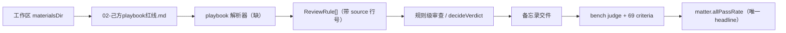

# 规则级审查接入 LawMind-Bench：对接评估

- 日期：2026-10-23
- 性质：**只读评估**。未改动 `../LawMind-Bench` 一个字节。
- 前提：`fixtures/lawmind-allpass/` 已声明仅为引擎夹具，评测归属 bench（见该目录 README「这不是 Benchmark」）

---

## 0. 结论

**对接点是「工作区 playbook 文件 → ReviewRule」，不是 bench 的 criteria。**

理由：bench 的架构已经把两者分开——playbook 作为**材料**放进工作区供 agent 读，69 条 criteria 只给裁判。
这个分法与 `ANTI-GAMING.md` 第 1 条（禁止把 criteria 写进 agent 提示）一致。任何从 criteria 反推规则的做法都是刷题。

真正缺的工程只有一件：**把律师 playbook 的散文抽成可判定的 ReviewRule**。
现在 `cn-sales-v0` 是硬编码 12 条，无法随律师自己的 playbook 变化——这是它不能进主路径的根本原因。

---

## 1. 现场事实（均已读源码/材料确认）

| 事实                                                                | 位置                                                                               |
| ------------------------------------------------------------------- | ---------------------------------------------------------------------------------- |
| bench 把 playbook 当材料                                            | `private/contract-review/saas-msa-redline-review/documents/02-己方playbook红线.md` |
| 同一题的 69 条 criteria 只给裁判                                    | 同目录 `task.json` → `criteria[]`                                                  |
| 合同审查确有红线题                                                  | `saas-msa-redline-review`，`workType: review`，69 criteria                         |
| `agentRequirements.lawmindModules` 点名 `playbook` / `minimal-edit` | 同 `task.json`                                                                     |

`task.json` 的一条 criterion 长这样：

```json
{
  "id": "C-004",
  "title": "识别责任上限3个月",
  "matchCriteria": "PASS if 3-month liability cap noted. FAIL if omitted."
}
```

它判的是**备忘录里有没有提到**，不是引擎判定的档位。两层不同，不能互相替代：

```
ReviewRule + decideVerdict   →  每条规则的档位（引擎层，可单测）
bench criteria + judge       →  交件是否覆盖该发现（产品层，发版口径）
```

---

## 2. 对接设计：playbook 是唯一的规则来源



三条硬边界：

1. **规则只从工作区文件读**，不内置任何题目专属规则。
2. **解析结果带 `source` 回指到 playbook 原文行**，律师能核；这也是 `ReviewRule.source` 字段的用途。
3. **不把 bench criteria 喂进引擎**。哪怕技术上做得到——那是 `ANTI-GAMING.md` 第 1 条明令禁止的。

---

## 3. 真实缺口：playbook 散文 → criteria

现有三份 playbook 材料格式差异很大：

| 来源                                        | 格式                            | 例子                                                                   |
| ------------------------------------------- | ------------------------------- | ---------------------------------------------------------------------- |
| SaaS（`02-己方playbook红线.md`）            | 分节散文 + 编号，阈值嵌在句子里 | 「责任上限不得低于 12 个月费用的 **100%**（数据泄露事件不低于 200%）」 |
| 租赁（`04-己方租赁playbook.md`）            | ID 前缀单行                     | `RL-L1 违约金不得超过剩余租期租金 30%`                                 |
| 采购验收（`11-己方红线清单-验收与付款.md`） | 三级编号，明确要求对应条款号    | 「一级：验收期不得少于 20 个工作日」                                   |

单一正则无法覆盖。需要：**LLM 抽取 + 机械校验**。

抽取产物必须满足 `ReviewRule` 的全部约束（`assertValidReviewRule` 已实现）：

- 每条 criterion 一个可二值化的问题，末尾问号；
- 拒绝条件分支 / 「是否适当」/ 「按法律规定」；
- 偏离类题面必须是缺陷问法（`verdictIfMet` 为 `unacceptable` / `acceptable_deviation` 时）；
- 必须至少一条 `compliant` 类，否则永远判不出合规。

**这些约束不是为夹具写的，是从「一句话能不能被判成两档」的语义要求推出来的**，因此对新 playbook 同样成立。这是它可迁移的原因。

---

## 3.1 机械层实测覆盖（2026-10-23，4 份真实 playbook）

已实现 `src/lawmind/review/playbook-parse.ts` 并跑过 bench 的 4 份真实 playbook
（只读，未拷入本仓）：

| 文件                            | 格式                 | 可判定行         | 需模型抽取 |
| ------------------------------- | -------------------- | ---------------- | ---------- |
| `04-己方租赁playbook.md`        | `RL-L1 …` 单行       | 3/3（100%）      | 0          |
| `11-己方红线清单-验收与付款.md` | 三级编号             | 15/16（94%）     | 1          |
| `02-己方playbook红线.md`        | 分节散文             | 3/25（12%）      | 22         |
| `08-内部红线对照表.md`          | `X → 红线 FAIL` 速记 | 1/22（5%）       | 21         |
| **合计**                        |                      | **22/66（33%）** | 44         |

**读法**：清单式/编号式 playbook 机械层能吃到 94–100%；**散文式只能吃 5–12%**。
所以真正的抽取主力必须是模型，机械层只做两件事：把结构化格式免费解决掉（省调用）、
以及给模型抽出来的结果做校验（`assertValidReviewRule`）。

一个被真实材料推翻的假设：我原来在测试里写「每份 playbook 都必须抽出 >0 条」。
`08` 那份用速记体，几乎抽不出——是假设错了，不是材料有问题。已把断言改成
「报告覆盖率，不假设覆盖率」。

## 4. 从真实材料发现的一个模型缺口

采购验收 playbook 自带三层，且描述精确：

> 一级为**不可让步**，二级为**原则不让步但可交换对价**，三级为**提示项**。

| playbook 层级 | 我的 `verdictIfMet` 现状 | 问题                                                                    |
| ------------- | ------------------------ | ----------------------------------------------------------------------- |
| 一级 不可让步 | `unacceptable`           | 对得上                                                                  |
| 二级 可交换   | `acceptable_deviation`   | 对得上                                                                  |
| 三级 提示项   | **无对应**               | 若映射到 `acceptable_deviation`，等于把「建议」说成「偏离」，会虚增缺陷 |

即：`ReviewRule` 缺一个「建议级」表达。可选做法有两条，**现在不决定**，先记下来：

- 加第六种 `advisory`：会破坏「五态」口径，影响面大；
- 归到 `compliant` 并在 rationale 里写建议：不改口径，但建议与结论混在一栏。

这是读真实材料才暴露的，不是靠调夹具能发现的。建议在真正接 bench 前先定这一条。

---

## 5. 可用的非过拟合验收集

bench 里现成有 **4 份来源不同的 playbook**，覆盖 3 个不同业务：

```
private/contract-review/saas-msa-redline-review/documents/02-己方playbook红线.md
private/contract-review/saas-msa-redline-review/documents/08-内部红线对照表.md
private/contract-review/office-lease-break-review/documents/04-己方租赁playbook.md
private/contract-review/t3-comm-cont-acceptance/documents/11-己方红线清单-验收与付款.md
```

这比我自己写的 26 份合成合同更有价值：**它们不是我写的**。

验收方式（解析器做完后）：

1. 对上述 4 份逐一抽规则，统计：抽出的规则数 / 原文中可判定的红线句数（人工数一遍）；
2. 抽出后跑 `assertValidReviewRule`，统计被拒条数与原因分布；
3. 抽 5 条规则，人工核对「这条规则是否忠实对应原文那一句」，不得出现原文没有的阈值。

**判定红线**：如果解析器只在 SaaS 那一份上有效，或者需要为每份写特例分支，就是失败的。
必须做到同一套抽取逻辑覆盖三种格式。

---

## 6. 明确不做（会被认定为刷题）

| 不做                                                  | 原因                                           |
| ----------------------------------------------------- | ---------------------------------------------- |
| 从 `task.json` 的 `criteria` 派生 ReviewRule          | 违反 `ANTI-GAMING.md` 第 1、12 条；分数会虚高  |
| 把「责任上限 12 个月 100%」等具体阈值硬编码进产品     | 那是某一个测试用例的数字，真实客户阈值各不相同 |
| 为某份 playbook 写 `if (fileName.includes(...))` 特例 | 过拟合签名                                     |
| 用 `lawmind:allpass` 的分数当发版 headline            | 该目录已声明不是 benchmark                     |
| 把 bench 的 `private/` 材料拷进产品仓                 | `INTEGRATION.md` 明令禁止                      |

---

## 7. 建议的最小路径

1. **先定第 4 节那个模型缺口**（三级提示项怎么表达）。它影响 `ReviewRule` 结构，晚改成本高。
2. **写 playbook 解析器**，位置建议 `src/lawmind/review/playbook-parse.ts`：
   - 输入：playbook 文本 + 文件名；
   - 输出：`ReviewRule[]`，每条带 `source` 行号；
   - 抽取后立即过 `assertValidReviewRule`，不合格的**返回问题清单而不是猜**；
   - 不做业务分支。
3. **用第 5 节的 4 份做验收**，不是用我自己的夹具。
4. 通过后再谈接 bench 的 `bench:lawmind` 全流程（那一步还需要模型额度与裁判配置）。

第 2 步的验收不消耗模型额度：解析器本身是「文本 → 结构」，可以先手工用一份 playbook 试跑结构校验，再决定是否引入 LLM 抽取。

---

## 8. 一句话

**规则级审查要活下来，靠的不是我的 12 条硬编码规则，而是能不能从任何一份律师 playbook 里抽出可判定的规则。**
bench 那 4 份现成 playbook 正好是这件事的验收材料，而且不是我写的。
