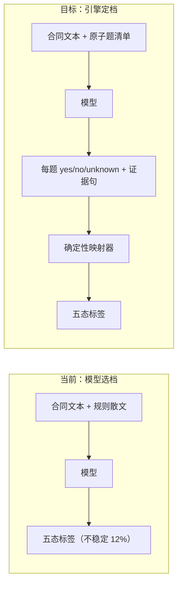

# 规则级判定收敛与存量红修复计划

- 日期：2026-10-22
- 依据：`fixtures/lawmind-allpass/README.md`「实测记录」的 4 轮实测 + 1 次稳定性验证
- 分支：`feat/automation-parity`（P2 建议独立分支）
- 状态：**待评审，未执行**

---

## 0. 核心诊断（决定整个计划的方向）

| 观察               | 数据                                          | 含义                                   |
| ------------------ | --------------------------------------------- | -------------------------------------- |
| prompt 迭代不收敛  | 15% → 45% → 75% → **50%**                     | 调措辞在五态间来回摆，不是能力问题     |
| 同代码同模型重跑   | s01 一次过、一次错 2 条                       | 单次数字是噪声                         |
| 3 次采样           | 12%（14/120）规则三次不一致                   | 模型对"该给哪一档"本身不稳定           |
| `compliant` 被降档 | 首轮 21 次 `compliant → acceptable_deviation` | 规则缺"合规充分条件"，模型按更严标准判 |

**结论：五态判定不该由模型直接给。** 模型擅长回答"这一条事实是否成立"，不擅长在五个法律档位里选一个。



---

## P0-1 · 原子化判定题 + 确定性定档（主修）

**为什么是主修**：只有把"选哪一档"从模型手里拿走，才可能收敛；这是分数可复现的前提。

### 数据结构

改 `src/lawmind/review/rules.ts`：

```ts
export type CriterionKind = "compliant" | "acceptable_deviation" | "unacceptable";

export type RuleCriterion = {
  id: string;
  /** 一个只能答是/否的事实问题，不要出现"是否适当"这类判断题。 */
  question: string;
  verdictIfMet: CriterionKind;
};

export type ReviewRule = {
  ruleId: string;
  title: string;
  paper: PaperSide;
  /** 给律师读的散文，不再作为判定依据。 */
  standard: string;
  criteria: RuleCriterion[];
  /** 条款完全未约定时是否允许。 */
  absentAllowed: boolean;
  guidance?: string;
  escalateWhen?: string;
  source: string;
};
```

`compliantWhen` / `acceptable` / `unacceptable` 三个字符串数组由 `criteria` 取代：散文留在 `standard`/`guidance`，**判定只依赖 `criteria`**。

### 映射器

新增 `src/lawmind/review/verdict.ts`（纯函数，无模型调用）：

```ts
export type CriterionAnswer = {
  criterionId: string;
  met: true | false | "unknown" | "not_applicable";
  evidence?: string;
};

export function decideVerdict(
  rule: ReviewRule,
  input: { clausePresent: boolean; answers: readonly CriterionAnswer[] },
): RuleClassification;
```

映射阶梯（顺序写死在代码里）：

1. `clausePresent === false` → `absentAllowed ? absent : unacceptable`
2. 任一 `verdictIfMet: "unacceptable"` 且 `met === true` → `unacceptable`
3. 任一 `verdictIfMet: "acceptable_deviation"` 且 `met === true` → `acceptable_deviation`
4. 全部 compliant 题 `met === true | "not_applicable"` → `compliant`
5. 存在 `met === "unknown"` → `needs_human`（rationale 带缺失的 criterion id）
6. 其余 → `acceptable_deviation`（未达合规但无 dealbreaker）

**硬约束**：映射器不接受"模型给了标签"这条输入路径，只接受 answers。

### worker 契约

改 `src/lawmind/agent/draft-worker.ts`：新增 `verdictAnswers: { clausePresent, answers[] }`，`rule_id` schema 段改成逐题作答。**删除旧 `classification` 字段**——留双路径等于留着"模型选档"。

### 验收

- 阶梯 6 个分支各一例 + 组合（多处 unacceptable 优先于 acceptable）
- 同一 answers 重复调用结果恒等
- `unknown` 必落 `needs_human` 且 rationale 带 criterion id
- 12 条规则全部迁移，每条 ≥2 题

**体量**：5–7 天

---

## P0-2 · 消除两条规则的二义性

实测弱项：`ip.data` 65%、`confidentiality` 80%。根因是规则内部有**条件分支**与**无定义边界**。

| 规则                         | 问题                                                                                                 | 修法                                                                                                                              |
| ---------------------------- | ---------------------------------------------------------------------------------------------------- | --------------------------------------------------------------------------------------------------------------------------------- |
| `ip.data`                    | "未涉及数据交付视为满足" 与 "数据使用限于合同目的" 两条路径冲突，模型时判 `absent` 时判 `acceptable` | 拆两道独立题：①"是否存在权属转让或超范围授权"（所有合同都问）②"若涉及数据交付，使用是否限于合同目的"（不涉及则 `not_applicable`） |
| `confidentiality.noncompete` | 三年/五年边界靠文字理解                                                                              | 改可数题：①"保密期是否 ≤ 3 年"②"是否设竞业限制"③"若设，是否同时有地域、期限、补偿"                                                |

改 `src/lawmind/review/playbooks/cn-sales.ts`。

**验收**：`--validate` 拒绝含条件分支的散文题（criterion 文本出现「如果/若…则」「视为满足」即报错）。

**体量**：2 天

---

## P1-1 · 夹具完整性校验

实测中发现的夹具缺陷现在只能靠读模型理由发现，应改在校验阶段就红。

新增 `src/lawmind/evaluation/fixture-integrity.ts`，接进 `lawmind:allpass --validate`：

| 检查           | 判据                                                                            |
| -------------- | ------------------------------------------------------------------------------- |
| 悬空附件引用   | 出现 `附件`/`附录` + 序号，但同一 case 无对应内容块                             |
| 不可判定措辞   | 补偿/金额处出现「按法律规定」「另行协商」「视情况」等无确定标准表述             |
| 缺失声明不明确 | `expected` 含 `absent` 但正文无显式「未约定××」句                               |
| 条款跳号       | 出现第一条、第二条、第六条，缺三至五且未声明缺失                                |
| 题面重叠       | 同一 case 内 `compliant` 与 `unacceptable` 题面高度重叠（防同一句判两个相反档） |

**验收**：把本轮发现的 4 类缺陷写成回归夹具，`--validate` 必须全部报红。

**体量**：1–1.5 天

---

## P1-2 · 测量协议

现在"改完就测"，规则与 prompt 一起变，分数无法归因。改成：

1. **`--trials` 默认 3**（模型臂）；单次采样须显式 `--trials 1` 并标注"不供引用"
2. **先报不稳定率，再报准确率**；`stable: false` 超阈值（如 5%）时报告头部打警告
3. **记录运行指纹**：rules hash + model + commit SHA + trials；无指纹的报告视为无效
4. **规则变更与测量分离**：同一 commit 不许既改规则又声称跑分提升

改 `scripts/lawmind/lawmind-allpass.ts`、`src/lawmind/evaluation/rule-allpass.ts` 的报告段。

**验收**：改一条规则后重跑，指纹变化可见；两次不同规则的报告标注不可对比。

**体量**：0.5 天

---

## P2 · CI 存量红清理（独立分支）

### (a) officecli 9 个测试：测试没隔离，不是环境缺失

`render-docx-tracked.test.ts` mock 了 `node:child_process`，但**没 mock `officecli-bin.ts`**：

- 本机 `/Users/shl/.local/bin/officecli` 存在 → 走 officecli 分支 → 断言通过
- CI 无此二进制 → `resolveOfficeCliBin` 返回 undefined → 短路到 `plain_fallback` → `ambiguous=0` → 失败

**修法**：测试里 `vi.mock("./officecli-bin.js", () => ({ resolveOfficeCliBin: () => "/stub/officecli" }))`。测试只验逻辑，不依赖机器装了什么。**不改 skip**——逻辑本身该被测。

### (b) shadow replay 4 个超时

`shadow-engine-replay` 3 例（180s / 120s / 60s）+ `closed-matter-shadow` 1 例（120s），已在未改动的 main 检出复现。

**修法**：先判定"真慢"还是"挂住"。单跑 verbose 看卡点；真慢则调 timeout 并记录基线；挂住则定位 await 环。**不接受直接 skip**。

### (c) file-size 13 处

`check-file-size.mjs --update` 会把当前行数写成新冻结上限，注释要求 "reviewed, justified growth"。

**修法**：逐条判断。真正该拆的（`LawmindWordRevisionSurface.tsx` 2884 行、`search-tools.ts` 1080 行）进拆分 backlog；略超的用 `--update` 并在 PR 说明。**不接受无脑一次性 `--update`**——那等于废掉棘轮。

**体量**：(a) 0.5 天；(b) 1 天；(c) 1–2 天

---

## 执行顺序

```text
P0-1 原子化判定（主修，阻塞其他）
  ├─ P0-2 规则二义性（同批，规则按新结构重写）
  ├─ P1-1 夹具校验（可并行，独立模块）
  └─ P1-2 测量协议（可并行）
       └─ 重跑 3 trials 验证不稳率
P2 CI 清理（独立分支，可并行）
```

**关键判定点**：P0-1 完成后重跑 3 trials。若不稳定率没有从 12% 明显下降，说明"原子题更稳定"这个假设错了，**应停下重新设计，而不是继续调 prompt**。

---

## 不做

- 不再靠改 prompt 措辞提升分数
- 不为让数字好看而放松夹具期望值
- 不在合成夹具上追求高 all-pass：它的用途是验证管道，不是证明法律能力
- 不删除 `stable: false` 观测——那是目前唯一可信的质量信号

## 全局验收

1. 同一 answers → 同一 verdict（确定性，单测覆盖）
2. 12 条规则全部由 `criteria` 驱动，散文不参与判定
3. `--validate` 能挡住本轮发现的 4 类夹具缺陷
4. 3 trials 重跑：不稳率显著低于 12%，且报告先报不稳率后报准确率
5. CI 三处存量红有明确归因而非 skip

---

## 实测结果（2026-10-22 当晚，deepseek-flash）

P0-1 机制已落地并用真实模型验证。**结论是反向的：该假设在当前模型上不成立。**
按本文「关键判定点」的刹车条件，停止继续调参。

### 做了什么

| 项                                                                        | 状态   |
| ------------------------------------------------------------------------- | ------ |
| `ReviewRule.criteria`（原子题）+ `decideVerdict`（确定性映射）            | 已落地 |
| worker 交 `verdictAnswers`，不再交档位；旧 `classification` 删除          | 已落地 |
| 12 条规则按 criteria 重写（含 ip.data / confidentiality 消歧）            | 已落地 |
| `verdict-oracle`：由期望档位反向合成答案；oracle 臂改为回放映射           | 已落地 |
| `fixture-integrity`：悬空附件、无确定标准措辞、缺失未声明、跳号、题面重复 | 已落地 |
| 测量协议：trials 默认 3、先报不稳率、运行指纹                             | 已落地 |

### 测出来的三个结果

| 轮次 | 配置                                           | all-pass         | 采样不稳定     |
| ---- | ---------------------------------------------- | ---------------- | -------------- |
| A    | 原子题，无补答（6 例 × 3 trials）              | 0%（0/6）        | **3%（1/36）** |
| B    | 加「漏答则补答一次」（6 例 × 3 trials）        | 0%（0/6）        | 53%（19/36）   |
| C    | 修极性标签 + 修三条规则题面（3 例 × 3 trials） | 0%（0/3）        | 39%（7/18）    |
| 对照 | 档位直选（20 例 × 3 trials，上一个提交）       | **55%（11/20）** | 12%（14/120）  |

### 为什么 0%

单例取证（s01，合成夹具里的「全项合规」样本）：

| 规则          | 映射结果             | 触发原因                                   |
| ------------- | -------------------- | ------------------------------------------ |
| dispute.forum | unacceptable         | 模型答「同时约定诉讼与仲裁」= true         |
| termination   | acceptable_deviation | 模型答「存在单方任意解除且通知不足」= true |
| ip.data       | unacceptable         | 模型答「授予超目的永久授权」= true         |

s01 原文分别是：只约定法院管辖、双方均可解除+催告、明确排除权属转让且数据限于合同目的。
**三条都是「缺陷不存在」，模型全答 true。**

即：`deepseek-flash` 对**否定型/缺陷型 yes-no 问题**系统性偏向 true。加了极性标签（「答 true 表示存在该缺陷」）没有改善。

轮次 A 的不稳率 3% 看似达标，但那是因为它大量漏答（漏答→unknown→needs_human，反而"稳定"）。
一旦要求答全，不稳率立刻回到 39–53%——比档位直选的 12% 更差。

### 判断

1. **「原子题更稳定」在当前模型上不成立。** 不稳的来源不是"选档"这个动作，而是模型对否定命题的阅读。
2. 档位直选（上一版）在同等预算下准确率**更高**（55% vs 0%），不稳率**更低**（12% vs 39%）。
3. 因此本计划的方向需要重新设计，而不是继续微调 prompt。可选路径：
   - **正向极性**：每道题只问「某项保护是否已具备」，缺陷由「未具备」推导，避免否定命题；
   - **换模型**：先测更强模型在同一批题上的极性正确率，再谈架构；
   - **回退档位直选**：保留本次的确定性映射与完整性校验作为外围设施，判定回到模型直选 + 多采样多数票。

### 保留的成果（与分数无关，仍然有用）

- `decideVerdict` 纯函数：同一答案恒等输出，可单测、可回放；这是可复现的前提。
- `verdict-oracle` + round-trip 测试：20 例 × 6 规则全部可还原，映射器不再靠人眼检查。
- `fixture-integrity`：上线即抓出我自己早前加的 3 处「未尽事宜按法律规定处理」，说明有效。
- 运行指纹与「先报不稳率」：即使这轮结论是负的，它也阻止了把 0% 或 55% 当成绩单。
- 采样补答机制：模型漏答是常态，这条对任何后续架构都需要。

### 下一步建议（未执行）

先花一次预算做**极性测试**：同一批合同，正向题问「是否具备 X 保护」，看 true/false 分布是否与已知事实一致。
如果正向题准确率显著高于反向题，再重写 criteria；否则应换模型或回退档位直选。

---

## 更新（2026-10-23）：假设被推翻一半，已找到真因

上一节结论「原子题假设不成立」**只对「批量作答」成立**。继续取证后推翻了其中
「模型读不懂否定命题」这一条判断。

### 追加的三组对照

`scripts/lawmind/lawmind-polarity-probe.ts`（探针，不参与生产路径）：

| 对照                           | 目的                          | 结果                                            |
| ------------------------------ | ----------------------------- | ----------------------------------------------- |
| 中性框架 + 正向/反向同事实对照 | 模型能否区分极性              | 矛盾 0/6                                        |
| 审查子工框架，同上             | 排除「找问题」角色导致偏 true | 矛盾 0/6                                        |
| 生产 criteria 逐题单问         | 排除「我的题面」这个变量      | s01 答对 28/29；`decideVerdict` 还原 12/12 档位 |

### 真因

**一次响应里塞 4–5 道题会塌陷**，逐题单问不会。同一批 criteria：
批量作答时 s01（全项合规）三条缺陷题全答 true；逐题单问时 s01/s02 全部正确。

### 修正后的结果

| 方案                              | all-pass         | 采样不一致      | 调用数/例 |
| --------------------------------- | ---------------- | --------------- | --------- |
| 档位直选                          | 55%（11/20）     | 12%             | 6         |
| 原子题批量作答                    | 0%（0/6）        | 39–53%          | 6         |
| **原子题逐题作答 + 先问条款存在** | **90%（18/20）** | **2%（3/120）** | ~29       |

### 三个顺带修掉的真 bug（都在我自己的代码里）

1. `clausePresent` 硬编码 `true` → `absent` 永不可达，s10/s11/s12 被判成偏离。
   改为每条规则先单独问一次「是否就此事作出约定」，答 false 直接短路。
2. 报告取「第一个有理由的样本」而非「多数票对应的样本」→ needs_human 的理由
   挂在 compliant 判定上，把诊断引向错误方向。
3. criterion「限于商业秘密，**并**明确排除已公开信息」塞了两个条件，无法二值回答
   → 改为单一条件。
4. 规则设计缺陷：`one_sided_termination` 缺「且不承担任何补偿」，导致
   「不对称但充分补偿」被误判为不可接受，吞掉 acceptable 档。

### 计划状态更新

- P0-1 / P0-2：**完成**，但最终形态是「逐题单问」，不是原计划的「一次交一个 answers 数组」。
- P1-1 / P1-2：完成。
- **未做**：生产路径接线（`draft_worker` 仍走旧的批量 `verdictAnswers`；本次只改
  benchmark 臂）。若要把逐题单问用于线上，需要先解决调用数 ×5 的成本问题
  （缓存、按规则并行、只对关键规则逐题问）。

---

## 留出集首次运行：结果无效（2026-10-23）

留出集在 `e68f494a2` 先行锁定（6 例，措辞与现有夹具不同），随后跑 26 例 × 3 trials。
**这次运行没有测出任何泛化结论**，原因如下。

### 发生了什么

| 观测              | 数值                                                                   |
| ----------------- | ---------------------------------------------------------------------- |
| 报告声称 all-pass | 69.2%（18/26）                                                         |
| 报告声称泛化      | 12.5%（1/8）                                                           |
| 实际失败原因      | `Model API error 402: {"message":"Insufficient Balance"}`              |
| 未测量的用例      | n07、n08、h01–h06（共 8 例；每例 6 规则 × 3 trials = 18 次调用全失败） |
| 白耗调用          | 144 次（余额耗尽后仍继续打完全部剩余用例）                             |

**12.5% 这个数字是假的**：8 个"失败"里 7 个是余额不足，不是判断错误。
真实情况是——前 18 例跑完（全部通过），第 19 例起账户余额耗尽。

**唯一被测的未调参用例是 s06（通过）**。n08 与 h01–h06 一次都没跑，
所以"泛化能力"这个问题**至今没有答案**，既不能说过拟合，也不能说不过拟合。

### 顺带修掉的真 bug

`isInfrastructureError()` 原来只认 401/403/unauthorized/api key，不认 402。
后果有三层：

1. 余额耗尽后不中止，继续对剩余 8 例发起 144 次注定失败的调用；
2. 这些失败被当成"模型判错"计入 all-pass 分母；
3. 报告照常打印一个准确率，看不出它几乎全由错误构成。

已修：

- `isInfrastructureError()` 覆盖 401/402/403/429、insufficient balance、quota、
  rate limit、连接类错误；命中即 `stoppedEarly` 并记录 `infraError`。
- 报告在 `infraError` 或 `stoppedEarly` 时**拒绝打印准确率**，改为
  `评分：无效（INVALID）`，并打印中止原因，明说"本报告不代表模型能力，
  也不代表过拟合或欠拟合"。
- 同一次运行里**不渲染泛化节**，避免拿一个空泛化率误导读者。
- 三个新测试锁住这三条：分类正确性、402 立即中止、普通模型失败不算基础设施错。

### 重申一条纪律

我在这次运行前一度把"6 例调后 100%、全量 50%"当成过拟合证据——
那 50% 里同样混着未测量的错误。**在跑分里区分「模型答错」与「根本没问成」，
是这类测量的第一道纪律**，这次差点没做到。

### 定位纠正（铁律 4）

写这份计划时我假设要在产品仓里建一套规则级 all-pass 评测。查过之后发现这是重复造：

| 已有资产                         | 内容                                                                                         |
| -------------------------------- | -------------------------------------------------------------------------------------------- |
| `../LawMind-Bench`（独立仓）     | 六分册、`private/held-out` 24 题冻结集、`ANTI-GAMING.md`（17 条硬规则）、`JUDGE-PROTOCOL.md` |
| 产品仓 `evaluation/benchmark.ts` | 黄金指令 + 期望特征、发版门控                                                                |
| 产品仓 `lawmind:human-baseline`  | 同题双稿盲评                                                                                 |

`lawmind:allpass` 是第三套，且规模只有 6 规则 × 26 份合成合同、工程撰写、无律师签字。
按 bench 自己的口径，这是 `authoredBy: engineering-draft`，**不得升 blocking、不得作 headline**。

因此定位收窄为：本目录只做**引擎层夹具**——验证规则能否结构化、答案能否确定性映射、
夹具是否自洽。质量与泛化的答案是 LawMind-Bench 的事，不是这里的事。
已在 `fixtures/lawmind-allpass/README.md` 加「这不是 Benchmark」边界声明。

### 下一步（需要额度）

补足 API 额度后重跑同一条命令即可（留出集已锁定，不需改任何夹具）：

```bash
DEEPSEEK_API_KEY=... pnpm lawmind:allpass --arm deepseek \
  --model deepseek-flash --trials 3 --concurrency 6 --workspace ./workspace
```

判读口径：

- 先看报告状态是否为 INVALID —— 是则完全无效，不谈数字；
- 再看「泛化」一节：那里才是未参与调参的用例；
- 若泛化率显著低于交付集（tunedOn）率，才可认定规则在配合夹具，需要重写规则而非继续调参。
