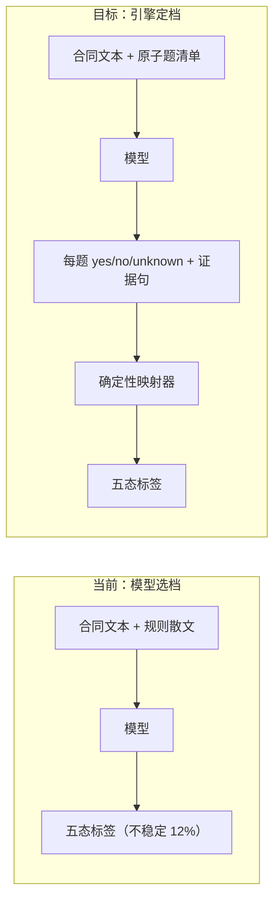

# 规则级判定收敛与存量红修复计划

- 日期：2026-10-22
- 依据：`fixtures/lawmind-allpass/README.md`「实测记录」的 4 轮实测 + 1 次稳定性验证
- 分支：`feat/automation-parity`（P2 建议独立分支）
- 状态：**待评审，未执行**

---

## 0. 核心诊断（决定整个计划的方向）

| 观察               | 数据                                          | 含义                                   |
| ------------------ | --------------------------------------------- | -------------------------------------- |
| prompt 迭代不收敛  | 15% → 45% → 75% → **50%**                     | 调措辞在五态间来回摆，不是能力问题     |
| 同代码同模型重跑   | s01 一次过、一次错 2 条                       | 单次数字是噪声                         |
| 3 次采样           | 12%（14/120）规则三次不一致                   | 模型对"该给哪一档"本身不稳定           |
| `compliant` 被降档 | 首轮 21 次 `compliant → acceptable_deviation` | 规则缺"合规充分条件"，模型按更严标准判 |

**结论：五态判定不该由模型直接给。** 模型擅长回答"这一条事实是否成立"，不擅长在五个法律档位里选一个。



---

## P0-1 · 原子化判定题 + 确定性定档（主修）

**为什么是主修**：只有把"选哪一档"从模型手里拿走，才可能收敛；这是分数可复现的前提。

### 数据结构

改 `src/lawmind/review/rules.ts`：

```ts
export type CriterionKind = "compliant" | "acceptable_deviation" | "unacceptable";

export type RuleCriterion = {
  id: string;
  /** 一个只能答是/否的事实问题，不要出现"是否适当"这类判断题。 */
  question: string;
  verdictIfMet: CriterionKind;
};

export type ReviewRule = {
  ruleId: string;
  title: string;
  paper: PaperSide;
  /** 给律师读的散文，不再作为判定依据。 */
  standard: string;
  criteria: RuleCriterion[];
  /** 条款完全未约定时是否允许。 */
  absentAllowed: boolean;
  guidance?: string;
  escalateWhen?: string;
  source: string;
};
```

`compliantWhen` / `acceptable` / `unacceptable` 三个字符串数组由 `criteria` 取代：散文留在 `standard`/`guidance`，**判定只依赖 `criteria`**。

### 映射器

新增 `src/lawmind/review/verdict.ts`（纯函数，无模型调用）：

```ts
export type CriterionAnswer = {
  criterionId: string;
  met: true | false | "unknown" | "not_applicable";
  evidence?: string;
};

export function decideVerdict(
  rule: ReviewRule,
  input: { clausePresent: boolean; answers: readonly CriterionAnswer[] },
): RuleClassification;
```

映射阶梯（顺序写死在代码里）：

1. `clausePresent === false` → `absentAllowed ? absent : unacceptable`
2. 任一 `verdictIfMet: "unacceptable"` 且 `met === true` → `unacceptable`
3. 任一 `verdictIfMet: "acceptable_deviation"` 且 `met === true` → `acceptable_deviation`
4. 全部 compliant 题 `met === true | "not_applicable"` → `compliant`
5. 存在 `met === "unknown"` → `needs_human`（rationale 带缺失的 criterion id）
6. 其余 → `acceptable_deviation`（未达合规但无 dealbreaker）

**硬约束**：映射器不接受"模型给了标签"这条输入路径，只接受 answers。

### worker 契约

改 `src/lawmind/agent/draft-worker.ts`：新增 `verdictAnswers: { clausePresent, answers[] }`，`rule_id` schema 段改成逐题作答。**删除旧 `classification` 字段**——留双路径等于留着"模型选档"。

### 验收

- 阶梯 6 个分支各一例 + 组合（多处 unacceptable 优先于 acceptable）
- 同一 answers 重复调用结果恒等
- `unknown` 必落 `needs_human` 且 rationale 带 criterion id
- 12 条规则全部迁移，每条 ≥2 题

**体量**：5–7 天

---

## P0-2 · 消除两条规则的二义性

实测弱项：`ip.data` 65%、`confidentiality` 80%。根因是规则内部有**条件分支**与**无定义边界**。

| 规则                         | 问题                                                                                                 | 修法                                                                                                                              |
| ---------------------------- | ---------------------------------------------------------------------------------------------------- | --------------------------------------------------------------------------------------------------------------------------------- |
| `ip.data`                    | "未涉及数据交付视为满足" 与 "数据使用限于合同目的" 两条路径冲突，模型时判 `absent` 时判 `acceptable` | 拆两道独立题：①"是否存在权属转让或超范围授权"（所有合同都问）②"若涉及数据交付，使用是否限于合同目的"（不涉及则 `not_applicable`） |
| `confidentiality.noncompete` | 三年/五年边界靠文字理解                                                                              | 改可数题：①"保密期是否 ≤ 3 年"②"是否设竞业限制"③"若设，是否同时有地域、期限、补偿"                                                |

改 `src/lawmind/review/playbooks/cn-sales.ts`。

**验收**：`--validate` 拒绝含条件分支的散文题（criterion 文本出现「如果/若…则」「视为满足」即报错）。

**体量**：2 天

---

## P1-1 · 夹具完整性校验

实测中发现的夹具缺陷现在只能靠读模型理由发现，应改在校验阶段就红。

新增 `src/lawmind/evaluation/fixture-integrity.ts`，接进 `lawmind:allpass --validate`：

| 检查           | 判据                                                                            |
| -------------- | ------------------------------------------------------------------------------- |
| 悬空附件引用   | 出现 `附件`/`附录` + 序号，但同一 case 无对应内容块                             |
| 不可判定措辞   | 补偿/金额处出现「按法律规定」「另行协商」「视情况」等无确定标准表述             |
| 缺失声明不明确 | `expected` 含 `absent` 但正文无显式「未约定××」句                               |
| 条款跳号       | 出现第一条、第二条、第六条，缺三至五且未声明缺失                                |
| 题面重叠       | 同一 case 内 `compliant` 与 `unacceptable` 题面高度重叠（防同一句判两个相反档） |

**验收**：把本轮发现的 4 类缺陷写成回归夹具，`--validate` 必须全部报红。

**体量**：1–1.5 天

---

## P1-2 · 测量协议

现在"改完就测"，规则与 prompt 一起变，分数无法归因。改成：

1. **`--trials` 默认 3**（模型臂）；单次采样须显式 `--trials 1` 并标注"不供引用"
2. **先报不稳定率，再报准确率**；`stable: false` 超阈值（如 5%）时报告头部打警告
3. **记录运行指纹**：rules hash + model + commit SHA + trials；无指纹的报告视为无效
4. **规则变更与测量分离**：同一 commit 不许既改规则又声称跑分提升

改 `scripts/lawmind/lawmind-allpass.ts`、`src/lawmind/evaluation/rule-allpass.ts` 的报告段。

**验收**：改一条规则后重跑，指纹变化可见；两次不同规则的报告标注不可对比。

**体量**：0.5 天

---

## P2 · CI 存量红清理（独立分支）

### (a) officecli 9 个测试：测试没隔离，不是环境缺失

`render-docx-tracked.test.ts` mock 了 `node:child_process`，但**没 mock `officecli-bin.ts`**：

- 本机 `/Users/shl/.local/bin/officecli` 存在 → 走 officecli 分支 → 断言通过
- CI 无此二进制 → `resolveOfficeCliBin` 返回 undefined → 短路到 `plain_fallback` → `ambiguous=0` → 失败

**修法**：测试里 `vi.mock("./officecli-bin.js", () => ({ resolveOfficeCliBin: () => "/stub/officecli" }))`。测试只验逻辑，不依赖机器装了什么。**不改 skip**——逻辑本身该被测。

### (b) shadow replay 4 个超时

`shadow-engine-replay` 3 例（180s / 120s / 60s）+ `closed-matter-shadow` 1 例（120s），已在未改动的 main 检出复现。

**修法**：先判定"真慢"还是"挂住"。单跑 verbose 看卡点；真慢则调 timeout 并记录基线；挂住则定位 await 环。**不接受直接 skip**。

### (c) file-size 13 处

`check-file-size.mjs --update` 会把当前行数写成新冻结上限，注释要求 "reviewed, justified growth"。

**修法**：逐条判断。真正该拆的（`LawmindWordRevisionSurface.tsx` 2884 行、`search-tools.ts` 1080 行）进拆分 backlog；略超的用 `--update` 并在 PR 说明。**不接受无脑一次性 `--update`**——那等于废掉棘轮。

**体量**：(a) 0.5 天；(b) 1 天；(c) 1–2 天

---

## 执行顺序

```text
P0-1 原子化判定（主修，阻塞其他）
  ├─ P0-2 规则二义性（同批，规则按新结构重写）
  ├─ P1-1 夹具校验（可并行，独立模块）
  └─ P1-2 测量协议（可并行）
       └─ 重跑 3 trials 验证不稳率
P2 CI 清理（独立分支，可并行）
```

**关键判定点**：P0-1 完成后重跑 3 trials。若不稳定率没有从 12% 明显下降，说明"原子题更稳定"这个假设错了，**应停下重新设计，而不是继续调 prompt**。

---

## 不做

- 不再靠改 prompt 措辞提升分数
- 不为让数字好看而放松夹具期望值
- 不在合成夹具上追求高 all-pass：它的用途是验证管道，不是证明法律能力
- 不删除 `stable: false` 观测——那是目前唯一可信的质量信号

## 全局验收

1. 同一 answers → 同一 verdict（确定性，单测覆盖）
2. 12 条规则全部由 `criteria` 驱动，散文不参与判定
3. `--validate` 能挡住本轮发现的 4 类夹具缺陷
4. 3 trials 重跑：不稳率显著低于 12%，且报告先报不稳率后报准确率
5. CI 三处存量红有明确归因而非 skip
